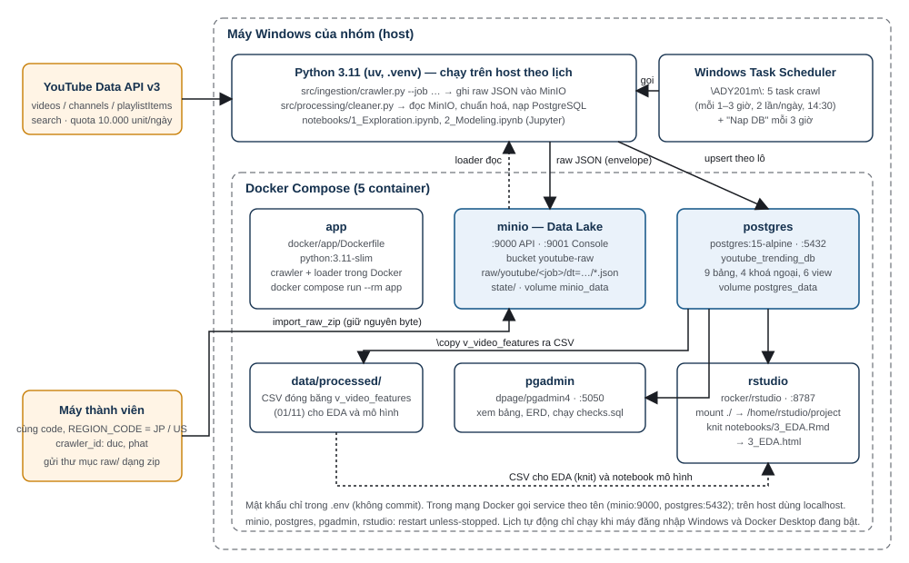
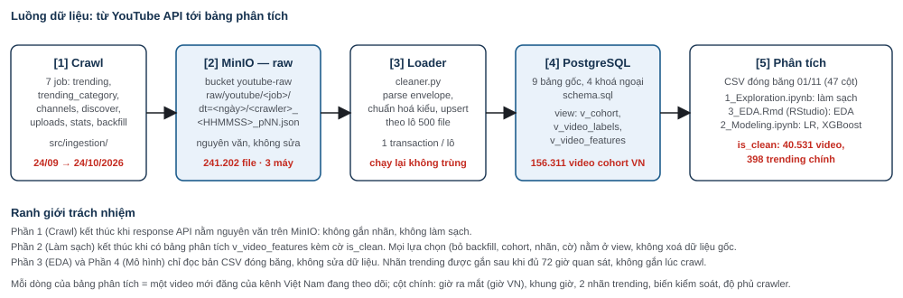

# Report 1 — Đề xuất nghiên cứu và kiến trúc hệ thống

<div class="cover">
<p class="course">ADY201m — AI, Data Science with Python &amp; SQL · FPT University</p>
<h1>Thời điểm vàng trên YouTube Việt Nam</h1>
<p class="sub">Report 1 — Research Proposal &amp; Architecture<br>Đề tài 4: Trending Content (YouTube)</p>
<table>
<tr><td>Câu hỏi nghiên cứu</td><td>Đăng video trong giờ hành chính hay giờ nghỉ thì dễ lọt Top Trending hơn?</td></tr>
<tr><td>Nhóm</td><td>BanNH — QE210137 (trưởng nhóm, phụ trách EDA và mô hình)<br>Nguyễn Lê Minh Đức (máy crawl JP, crawler_id <code>duc</code>)<br>Lâm Duy Phát (máy crawl US, crawler_id <code>phat</code>)</td></tr>
<tr><td>Repo</td><td><code>BanNH_QE210137_TRENDING_ANALYTICS</code> (GitHub, private)</td></tr>
<tr><td>Phiên bản</td><td>Đề xuất lập tuần 1–2; bản này cập nhật ngày 14/11/2026 theo thực tế triển khai</td></tr>
</table>
<p class="note">Báo cáo viết để đọc độc lập, không cần thuyết trình kèm. Mọi số liệu "thực tế" trong mục 10 lấy từ cơ sở dữ liệu của nhóm tại mốc 01/11/2026.</p>
</div>
<!-- TOC -->

## Tóm tắt

Đề tài hỏi một câu mà người làm nội dung YouTube hay tự hỏi: **đăng video vào giờ hành chính (08:00–16:59, thứ 2–6) hay vào giờ nghỉ thì dễ lọt Top Trending hơn?** Nhóm trả lời câu này bằng dữ liệu tự thu thập từ YouTube Data API v3, với một thiết kế tránh được các bẫy quen thuộc của "dữ liệu trending": trending chỉ là khoảnh khắc nên phải chụp liên tục; chỉ có video trending thì không so sánh được nên phải thu thập cả video không trending của cùng các kênh; kênh lớn vừa dễ trending vừa có thói quen đăng giờ riêng nên phải có biến kiểm soát.

Giả thuyết được phát biểu dưới dạng H₀/H₁ và được đánh giá hai lần: bằng phân tích khám phá có khoảng tin cậy (Report 3) và bằng hai mô hình phân loại (Report 4). Hệ thống chạy hoàn toàn bằng Docker Compose với năm container (MinIO, PostgreSQL, pgAdmin, app Python, RStudio), theo đúng kiến trúc Data Lake → Database → Analysis mà môn học yêu cầu.

## Bối cảnh và câu hỏi nghiên cứu

### Đề tài 4 gợi ý gì

Đề tài "Trending Content (YouTube)" gợi ý ba hướng: (1) thời điểm đăng (giờ hành chính so với giờ nghỉ) có liên quan tới việc lọt trending không; (2) dislike hoặc bình luận tiêu cực có liên quan tới độ lan truyền không; (3) từ khoá giật gân trong tiêu đề ("SỐC", "LỘ", "REVIEW") có liên quan tới lượt xem không.

Nhóm chọn **hướng 1** vì hai lý do. Thứ nhất, đây là câu hỏi có biến giải thích rõ ràng (giờ đăng) và biến kết quả đo được bằng API (có mặt trên chart `mostPopular`). Thứ hai, hướng 2 không còn khả thi: YouTube Data API không trả số dislike từ năm 2021. Hướng 3 có thể làm thêm nếu còn thời gian, nhưng không phải trọng tâm.

### Câu hỏi nghiên cứu

> **Thời điểm vàng:** với một video mới đăng của một kênh YouTube Việt Nam đang được theo dõi, đăng trong **giờ hành chính** (08:00–16:59, thứ 2 đến thứ 6, giờ Việt Nam) hay **giờ nghỉ** (mọi thời điểm còn lại, kể cả thứ 7 và chủ nhật) thì khả năng lọt Top Trending trong 72 giờ đầu cao hơn?

Đơn vị phân tích là **một video mới đăng**. Câu hỏi là về *khả năng* (tỉ lệ), không phải về số lượng tuyệt đối, vì số video đăng trong hai khung giờ khác nhau.

## Giả thuyết và cách kiểm định

### Phát biểu giả thuyết

- **H₀:** khả năng lọt trending của video đăng trong giờ hành chính **bằng** khả năng của video đăng trong giờ nghỉ, khi đã kiểm soát ngày đăng, quy mô kênh, thể loại và thời lượng.
- **H₁:** hai khả năng này **khác nhau**.

Cụm "khi đã kiểm soát" là phần quan trọng nhất của giả thuyết. Nếu chỉ so tỉ lệ thô, kết quả có thể chỉ phản ánh việc hai khung giờ có *loại video khác nhau* (ví dụ giờ hành chính nhiều tin tức, giờ tối nhiều video game dài), chứ không phải tác dụng của giờ đăng.

### Hai bước đánh giá

| Bước | Report | Cách làm | Kết quả mong đợi |
|---|---|---|---|
| Phân tích khám phá | Report 3 | So tỉ lệ trending giữa hai khung giờ kèm khoảng tin cậy 95% (Wilson); kiểm soát từng yếu tố nhiễu bằng tỉ số Mantel–Haenszel với khoảng tin cậy bootstrap theo kênh | Biết chênh lệch thô là bao nhiêu và còn lại bao nhiêu sau khi kiểm soát |
| Mô hình | Report 4 | Logistic Regression cho odds ratio của khung giờ kèm khoảng tin cậy; XGBoost đo khung giờ đóng góp bao nhiêu vào dự đoán. Chia train/test theo kênh | Chấp nhận hay bác bỏ H₀ theo quy tắc chốt trước |

**Quy tắc kết luận (chốt trước khi xem kết quả):** bác bỏ H₀ nếu khoảng tin cậy 95% của odds ratio giờ nghỉ / giờ hành chính trong mô hình đủ kiểm soát **không chứa 1**; ngược lại kết luận "chưa đủ bằng chứng bác bỏ H₀". Mô hình thứ hai chỉ dùng để xác nhận chiều của kết quả.

Đề xuất ban đầu (tuần 2) dự định dùng kiểm định p-value trên hệ số hồi quy. Sau khi làm sạch dữ liệu, nhóm chuyển sang trình bày bằng **khoảng tin cậy và độ lớn chênh lệch**, vì cỡ mẫu lớn làm p-value nhỏ ngay cả với chênh lệch không đáng kể, và vì khoảng tin cậy cho biết thêm chênh lệch *lớn tới đâu*. Quy tắc "khoảng tin cậy chứa 1 hay không" tương đương với kiểm định ở mức 5%.

### Dữ liệu quan sát nói được gì

Dữ liệu là dữ liệu quan sát, không phải thí nghiệm: nhóm không chọn ngẫu nhiên giờ đăng cho video. Vì vậy, dù kết quả thế nào, đề tài chỉ kết luận được giờ đăng **đi kèm** với khả năng trending cao hơn hay không, chứ không kết luận được giờ đăng **gây ra** điều đó. Điểm này được ghi rõ ở mọi báo cáo.

## Định nghĩa thao tác

| Khái niệm | Định nghĩa dùng trong đồ án |
|---|---|
| Giờ ra mắt (`release_at`) | `snippet.publishedAt` của API. Với livestream hoặc Premiere dùng `liveStreamingDetails.actualStartTime` (lúc khán giả thực sự xem được), vì YouTube đổi `publishedAt` thành lúc phát xong |
| Giờ hành chính | 08:00–16:59, thứ 2 đến thứ 6, giờ Việt Nam (UTC+7) |
| Giờ nghỉ | Mọi thời điểm còn lại: tối, đêm, sáng sớm ngày thường và cả ngày thứ 7, chủ nhật |
| Lọt trending, chart chính | Có mặt trong ít nhất một lần chụp danh sách `mostPopular` khu vực VN trong vòng 72 giờ kể từ giờ ra mắt |
| Lọt trending, chart danh mục | Như trên, với danh sách `mostPopular` của từng danh mục (`videoCategoryId`). Hai nhãn tách riêng vì hai chart có cách chọn video khác nhau |
| Độ phủ crawler | Tỉ lệ số giờ có lần chụp chart trong 24 giờ và 72 giờ đầu của video. Độ phủ thấp thì nhãn "không trending" không đáng tin |
| Kênh Việt Nam | Kênh khai báo `country = VN`, hoặc không khai quốc gia nhưng ngôn ngữ mặc định là tiếng Việt |
| Biến kiểm soát | Ngày đăng, số subscriber của kênh, thể loại (danh mục YouTube), thời lượng, livestream hay không |

## Dữ liệu cần có và sáu bẫy phải tránh

### Bảng dữ liệu đích

Mọi quyết định thu thập đều nhằm dựng được một bảng, mỗi dòng là một video mới đăng:

| video_id | giờ ra mắt (VN) | khung giờ | trending chính? | trending danh mục? | subscriber kênh | thể loại | thời lượng | độ phủ 72h |
|---|---|---|---|---|---|---|---|---|
| abc | 19:30 thứ 6 | nghỉ | 1 | 1 | 2,1 triệu | Âm nhạc | 4 phút | 0,75 |
| xyz | 10:00 thứ 3 | hành chính | 0 | NULL | 2,1 triệu | Âm nhạc | 3 phút | 0,64 |

Crawler chỉ thu thập nguyên liệu thô. Bảng này được dựng ở tầng xử lý, sau khi mỗi video đã có đủ 72 giờ quan sát.

### Sáu bẫy và quyết định thiết kế tương ứng

| # | Bẫy | Hậu quả nếu bỏ qua | Quyết định thiết kế |
|---|---|---|---|
| 1 | Trending là khoảnh khắc; API không lưu lịch sử | Video chỉ trending vài giờ bị bỏ lỡ, gán nhầm nhãn 0 | Chụp chart mỗi giờ, lưu nguyên văn; đo độ phủ để loại video crawler không theo dõi đủ |
| 2 | Chỉ có video trending thì không có gì để so sánh (survivorship bias) | "70% video trending đăng buổi tối" không chứng minh được gì nếu 70% video nói chung cũng đăng buổi tối | Thu thập mọi video mới của cùng các kênh làm nhóm so sánh |
| 3 | Nhóm so sánh phải công bằng | Lấy video ngẫu nhiên thì khác ngôn ngữ, khác thời kỳ | Nhóm so sánh lấy từ chính các kênh đó, cùng giai đoạn |
| 4 | Biến gây nhiễu: kênh lớn vừa dễ trending vừa có giờ đăng riêng | Kết luận nhầm "giờ X là giờ vàng" | Thu thập subscriber, thể loại, thời lượng để kiểm soát |
| 5 | YouTube đổi định nghĩa trending (từ 21/07/2025, chart `mostPopular` chỉ lấy từ bảng Âm nhạc, Phim, Game) | Nhãn lệch về vài thể loại | Không có biến thay thế; ghi nhận là hạn chế và thêm chart theo danh mục làm nhãn thứ hai |
| 6 | Thời gian phức tạp: API trả giờ UTC, Premiere có giờ phát riêng, video có thể trending muộn | Lệch 7 tiếng, nhãn sai | Lưu giờ gốc; đổi múi giờ và gắn nhãn ở tầng xử lý khi đã đủ lịch sử |

## Kế hoạch thu thập dữ liệu

### Bảy job, mỗi job trả lời một mảnh của câu hỏi

```
trending, trending_category ──► channels ──► uploads ──► stats
                                     ▲
                       discover ─────┘──► backfill
```

| Job | Làm gì | Lịch | Cung cấp cho nghiên cứu |
|---|---|---|---|
| `trending` | Chụp chart `mostPopular` VN (khoảng 200 video mỗi lần) | mỗi giờ | Nhãn chính `is_trending_main`, kèm thứ hạng |
| `trending_category` | Chụp chart `mostPopular` của từng danh mục | mỗi 3 giờ | Nhãn danh mục `is_trending_category` |
| `channels` | Tra thông tin kênh từng có video trending | 2 lần/ngày | Biến kiểm soát: subscriber, quốc gia, playlist uploads |
| `discover` | Tìm thêm kênh Việt Nam qua 76 từ khoá và mục "kênh nổi bật" | 1 lần/ngày | Mở rộng, đa dạng hoá tập kênh ngoài Âm nhạc và Game |
| `uploads` | Lấy mọi video mới (7 ngày) của các kênh đang theo dõi | 2 lần/ngày | Nhóm so sánh và biến giải thích (giờ đăng) |
| `stats` | Chụp view, like, comment của video mới mỗi 3 giờ trong 3 ngày đầu | mỗi 3 giờ | Tham khảo; không dùng để kiểm định vì view là hệ quả của trending |
| `backfill` | Lịch sử 30 ngày của kênh, tối đa 50 video mỗi kênh | 1 lần/ngày | Không có nhãn đáng tin; chỉ tăng khối lượng Data Lake |

### Nguyên tắc vận hành

- **Lưu nguyên văn:** mỗi response của API được bọc trong một envelope (`crawler_id`, `job`, `crawl_time_utc`, `request`, `page_index`, `response`) và lưu thành một object trên MinIO theo đường dẫn `raw/youtube/<job>/dt=<ngày UTC>/<crawler_id>_<HHMMSS>_p<trang>.json`. Không sửa, không lọc. Mọi xử lý làm ở tầng sau, nên luôn dựng lại được database từ Data Lake.
- **Quota:** Google cấp 10.000 unit mỗi ngày cho một project. Nhóm đặt hai mức trần: job thiết yếu được dùng tới 9.500 unit; job nặng (`discover`, `backfill`) phải dừng khi tổng cả ngày chạm 7.000 unit, để job `trending` của các giờ sau không bao giờ bị đói quota. Không dùng nhiều project để lách quota.
- **Chạy không người trông:** Windows Task Scheduler gọi crawler theo lịch; tiến độ các job dài lưu trong `state/` trên MinIO để lần chạy sau làm tiếp từ chỗ dừng.
- **Nhãn gắn sau:** nhãn trending không gắn lúc crawl, vì video đăng hôm nay có thể lên trending ngày mai. Tầng xử lý gắn nhãn khi video đã có đủ 72 giờ quan sát.

### Nhiều máy crawl, nhiều khu vực

Hai thành viên dùng cùng mã nguồn, đổi `REGION_CODE` và chạy trên máy riêng: JP (crawler `duc`) và US (crawler `phat`). Dữ liệu của họ được gộp vào cùng database qua cột `region_code`, gán theo tên máy crawl trong tên file. Phân tích chính chỉ dùng dữ liệu khu vực VN; JP và US dùng để mô tả, vì hai máy đó chụp chart thưa hơn nhiều.

## Kiến trúc hệ thống

### Sơ đồ Docker



| Container | Image | Vai trò | Cổng |
|---|---|---|---|
| `ady201m_minio` | `quay.io/minio/minio` | Data Lake tương thích S3, bucket `youtube-raw` (tầng `raw/` và `state/`) | 9000 (API), 9001 (Console) |
| `ady201m_postgres` | `postgres:15-alpine` | Database đích: 9 bảng gốc, 4 khoá ngoại, các view phân tích | 5432 |
| `ady201m_pgadmin` | `dpage/pgadmin4` | Giao diện quản lý PostgreSQL, xem ERD, chạy SQL kiểm tra | 5050 |
| `ady201m_app` | build từ `docker/app/Dockerfile` (python:3.11-slim) | Crawler và loader chạy trong Docker: `docker compose run --rm app` | — |
| `ady201m_rstudio` | build từ `docker/rstudio/Dockerfile` (rocker/rstudio) | EDA bằng R Markdown, repo được mount tại `/home/rstudio/project` | 8787 |

Ba nguyên tắc cấu hình: mật khẩu chỉ nằm trong `.env` (không commit); thông số không bí mật nằm trong `configs/db_config.json`; trong mạng Docker các dịch vụ gọi nhau theo tên (`minio:9000`, `postgres:5432`), còn trên máy host dùng `localhost`. `minio`, `postgres`, `pgadmin`, `rstudio` có `restart: unless-stopped` để tự bật lại cùng Docker.

### Luồng dữ liệu



| Tầng | Công cụ | Đầu vào | Đầu ra |
|---|---|---|---|
| Ingestion | `src/ingestion/crawler.py --job <tên job>` | YouTube Data API v3 | Object JSON nguyên văn trên MinIO |
| Processing | `src/processing/cleaner.py` | Object trên MinIO | 9 bảng PostgreSQL (`configs/schema.sql`), view nhãn (`labels.sql`), bảng phân tích (`features.sql`) |
| Analysis | `notebooks/1_Exploration.ipynb` (làm sạch), `notebooks/3_EDA.Rmd` (RStudio), `notebooks/2_Modeling.ipynb` (mô hình) | Bản CSV đóng băng của `v_video_features` | Kết luận về giả thuyết |

### Cấu trúc repo

```
.gitignore · README.md · AI_Log.md · docker-compose.yml · requirements.txt · pyproject.toml
configs/        db_config.json, schema.sql, labels.sql, features.sql, checks.sql, discover_keywords.txt
docker/         app/Dockerfile, rstudio/Dockerfile
src/            ingestion/ (crawler.py, jobs/), processing/cleaner.py, modeling/, utils/
data/           raw/sample/ (mỗi job 1 file mẫu), processed/ (CSV mẫu; bản đầy đủ không commit)
notebooks/      1_Exploration.ipynb, 2_Modeling.ipynb, 3_EDA.Rmd
reports/        Report_N_*.pdf, data_dictionary.md
docs/           HOW_TO_SETUP.md, analysis/ (giải thích từng bài toán của 4 phần)
```

Cấu trúc này theo đúng yêu cầu của môn (thiếu thư mục bắt buộc thì report bị 0 điểm), và chia theo tầng để mỗi report có thể chỉ vào đúng phần mã nguồn của mình.

## Kế hoạch theo từng report

| Report | Tuần | Trọng số | Nội dung | Sản phẩm trong repo |
|---|---|---|---|---|
| 1 | 1–2 | 10% | Đề xuất, giả thuyết, kiến trúc Docker, dựng repo | Báo cáo này; `docker-compose.yml`; cấu trúc thư mục |
| 2 | 3–4 | 20% | MinIO trên Docker; pipeline Crawl → MinIO → PostgreSQL; chứng minh dữ liệu đã vào lake; SQL kiểm tra | `src/ingestion/`, `src/processing/cleaner.py`, `configs/*.sql`, `reports/Report_2_*.pdf` |
| 3 | 5–6 | 10% | Notebook làm sạch; EDA bằng RStudio; data dictionary | `notebooks/1_Exploration.ipynb`, `notebooks/3_EDA.Rmd`, `reports/data_dictionary.md`, `reports/Report_3_*.pdf` |
| 4 | 7–8 | 20% | Hai mô hình phân loại; đánh giá và so sánh; chấp nhận hay bác bỏ H₀ | `src/modeling/`, `notebooks/2_Modeling.ipynb`, `reports/Report_4_*.pdf` |
| 5 | 9–10 | 20% | Đóng gói `docker compose up`; demo; bảo vệ | Slide, demo |

### Phân công nhóm

| Việc | Người |
|---|---|
| Thiết kế câu hỏi, giả thuyết, kiến trúc; viết crawler, loader, schema; EDA khu vực VN; Logistic Regression; kết luận và tổng hợp báo cáo | BanNH |
| Crawl khu vực JP bằng cùng mã nguồn; trình bày pipeline tự động (Report 3); XGBoost: giải thích và bảng so sánh mô hình (Report 4) | Nguyễn Lê Minh Đức (`duc`) |
| Crawl khu vực US bằng cùng mã nguồn; trình bày phần làm sạch (Report 3); XGBoost: huấn luyện và tinh chỉnh (Report 4) | Lâm Duy Phát (`phat`) |

Quy ước commit: theo conventional commits (`feat:`, `fix:`, `docs:`, `chore:`), ít nhất 2 commit mỗi tuần, không có message kiểu "update". Mọi lần dùng AI được ghi vào `AI_Log.md`.

## Rủi ro và hạn chế lường trước

| Rủi ro | Ảnh hưởng | Biện pháp |
|---|---|---|
| Crawler chạy trên máy cá nhân, không bật 24/7 | Giờ nào crawler tắt thì chart của giờ đó mất vĩnh viễn; video trending đúng lúc đó bị gán nhầm nhãn 0 | Đo độ phủ cho từng video; chỉ phân tích tập có độ phủ đủ; làm bảng độ nhạy theo ngưỡng |
| Định nghĩa trending của YouTube đã đổi (07/2025) | Chart chính gần như chỉ có Âm nhạc, Phim, Game; positive ít và lệch thể loại | Thêm chart theo danh mục làm nhãn thứ hai; kiểm soát thể loại trong phân tích |
| Rất ít video lọt trending so với không lọt | Mô hình dễ đoán "không" cho tất cả; accuracy vô nghĩa | Trọng số lớp; đánh giá bằng PR-AUC, recall, F1; luôn so với mô hình mốc |
| Video cùng kênh giống nhau | Khoảng tin cậy quá hẹp; mô hình "nhớ kênh" | Bootstrap theo kênh; chia train/test theo kênh |
| Quota 10.000 unit mỗi ngày | Giới hạn số kênh theo dõi và tần suất chụp | Hai mức trần quota; `search.list` (100 unit) chỉ dùng cho `discover` |
| Số subscriber lấy tại lần chụp mới nhất | Biến kiểm soát lệch nhẹ so với lúc video đăng | Dùng theo nhóm độ lớn; khoảng thu thập chỉ 4 tuần nên sai lệch nhỏ |
| Tập kênh không đại diện cho toàn bộ YouTube Việt Nam | Kết luận chỉ đúng cho kênh đang hoạt động trong danh sách theo dõi | Ghi rõ phạm vi |
| Không có dislike | Không làm được hướng 2 của đề tài | Chọn hướng 1 |

## Tình trạng tại thời điểm cập nhật

Phần này ghi lại kế hoạch đã được thực hiện tới đâu, để người đọc đối chiếu đề xuất với thực tế.

| Hạng mục | Kế hoạch | Thực tế (mốc 01/11/2026) |
|---|---|---|
| Thời gian thu thập (máy VN) | 25/09 – 09/10 (ước tính ban đầu) | 24/09 – 24/10/2026 |
| Số file raw trên MinIO | — | 241.202 file (VN 176.023; JP 52.215; US 12.964) |
| Database | 9 bảng, 4 khoá ngoại | Đúng như thiết kế; mọi file raw đều có dòng trong `raw_files` |
| Cohort (video mới, theo dõi trọn 72 giờ) | 10.000–15.000 video | 156.311 video, 1.029 trending chính |
| Tập sạch nhãn chính (độ phủ ≥ 0,6) | — | 40.531 video, 398 trending |
| Tập sạch nhãn danh mục (độ phủ ≥ 0,3) | — | 39.669 video, 1.283 trending |
| Độ phủ crawler | Chạy liên tục | Chỉ 412 trên 704 giờ có lần chụp (58,5%); khoảng tắt dài nhất 94 giờ |

Hai điểm khác so với đề xuất ban đầu: (1) cách kiểm định chuyển từ p-value sang khoảng tin cậy và quy tắc chốt trước, như giải thích ở mục 3; (2) số video thu được lớn hơn ước tính nhiều lần nhờ job `discover` mở rộng tập kênh, nhưng độ phủ crawler thấp hơn dự kiến, nên bước làm sạch (Report 3) phải thêm khái niệm độ phủ và tập sạch.
