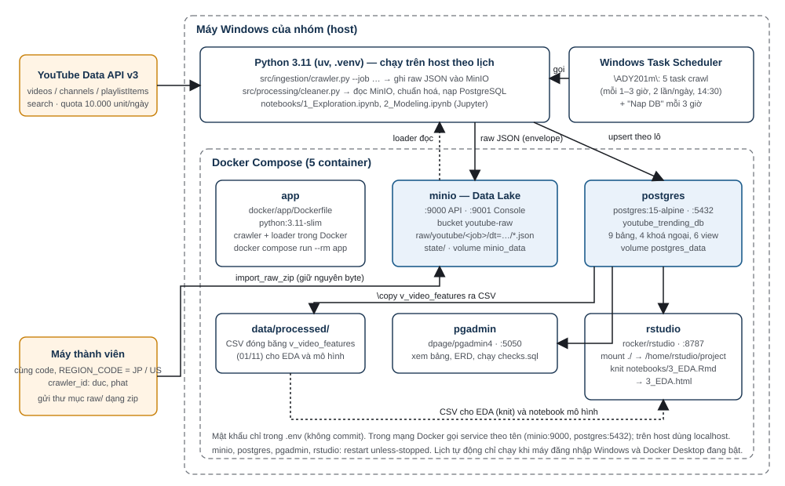
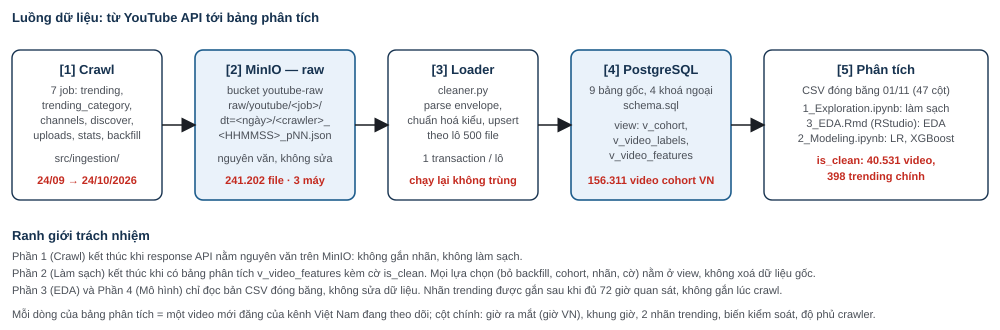
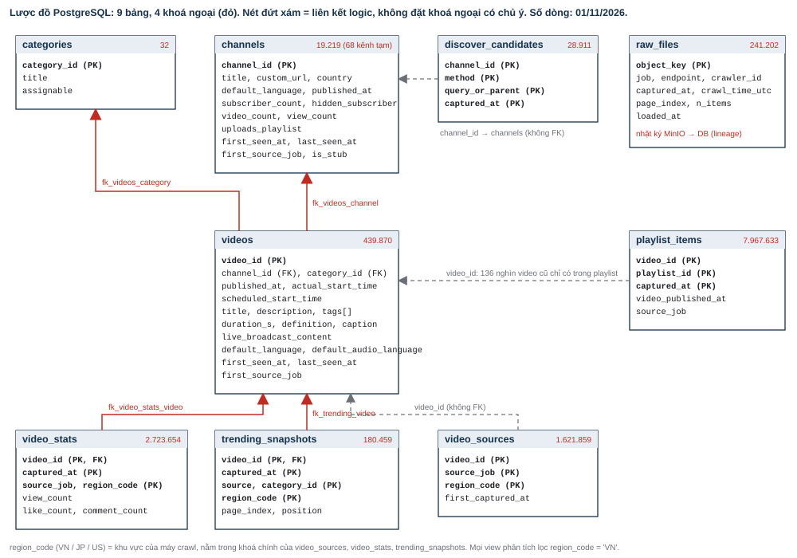

# Report 2 — Data Lake và Data Engineering

<div class="cover">
<p class="course">ADY201m — AI, Data Science with Python &amp; SQL · FPT University</p>
<h1>Pipeline dữ liệu: YouTube API → MinIO → PostgreSQL</h1>
<p class="sub">Report 2 — Data Lake &amp; Engineering<br>Đề tài 4: Trending Content (YouTube) — Thời điểm vàng trên YouTube Việt Nam</p>
<table>
<tr><td>Nhóm</td><td>BanNH — QE210137 (thiết kế và viết pipeline, loader, schema)<br>Nguyễn Lê Minh Đức (máy crawl JP, crawler_id <code>duc</code>)<br>Lâm Duy Phát (máy crawl US, crawler_id <code>phat</code>)</td></tr>
<tr><td>Mốc số liệu</td><td>Lần nạp đầy đủ 21/10/2026 (bảng theo job); gộp dữ liệu JP/US 30/10; số dòng cuối 01/11/2026</td></tr>
<tr><td>Mã nguồn</td><td><code>src/ingestion/</code>, <code>src/processing/cleaner.py</code>, <code>configs/schema.sql</code>, <code>labels.sql</code>, <code>checks.sql</code></td></tr>
</table>
<p class="note">Báo cáo viết để đọc độc lập. Mọi con số đều có thể tái lập bằng SQL trong <code>configs/checks.sql</code>; output đầy đủ ở <code>reports/report2_sql_checks_output.txt</code>.</p>
</div>
<!-- TOC -->

## Mục tiêu và kết quả chính

Report 2 phải chứng minh ba điều: (1) MinIO chạy trên Docker và nhận được dữ liệu thô; (2) có pipeline mã nguồn đưa dữ liệu từ YouTube API vào MinIO rồi vào database; (3) dữ liệu trong database được kiểm tra bằng SQL.

<div class="kq">
<p><strong>Kết quả.</strong> Pipeline chạy tự động từ 24/09 tới 24/10/2026. Data Lake MinIO chứa <strong>241.202 file JSON</strong> nguyên văn của 7 job từ 3 máy crawl (VN 176.023, JP 52.215, US 12.964). Loader đọc lại từ MinIO, chuẩn hoá kiểu dữ liệu và nạp vào PostgreSQL thành <strong>9 bảng, 4 khoá ngoại</strong>; mọi file đã nạp đều có dòng trong bảng <code>raw_files</code> nên nạp lại không bao giờ trùng. <strong>14 nhóm SQL kiểm tra</strong> cho 0 trùng khoá, 0 vi phạm khoá ngoại. Từ 9 bảng, các view dựng được bảng phân tích có nhãn: <strong>156.311 video mới</strong> của khu vực VN, trong đó 1.029 video lọt chart chính trong 72 giờ đầu.</p>
</div>

Bài toán phía sau pipeline: trả lời câu hỏi "đăng video giờ hành chính hay giờ nghỉ thì dễ lọt Top Trending hơn" (Report 1). Mọi quyết định kỹ thuật dưới đây đều phục vụ việc dựng được bảng "mỗi dòng là một video mới, biết giờ đăng, biết có lọt trending trong 72 giờ hay không, kèm biến kiểm soát".

## Kiến trúc hệ thống

Toàn bộ hệ thống chạy bằng Docker Compose (`docker-compose.yml`, project `ady201m_trending`):

| Container | Image | Vai trò | Cổng |
|---|---|---|---|
| `ady201m_minio` | `quay.io/minio/minio` | Data Lake tương thích S3, bucket `youtube-raw` | 9000 (API), 9001 (Console) |
| `ady201m_postgres` | `postgres:15-alpine` | Database đích sau làm sạch, `youtube_trending_db` | 5432 |
| `ady201m_pgadmin` | `dpage/pgadmin4` | Giao diện quản lý PostgreSQL | 5050 |
| `ady201m_app` | build từ `docker/app/Dockerfile` | Python 3.11: crawler và loader | — |
| `ady201m_rstudio` | build từ `docker/rstudio/Dockerfile` | RStudio cho EDA (Report 3) | 8787 |



Trong mạng Docker, container `app` gọi các dịch vụ bằng tên (`minio:9000`, `postgres:5432`); khi chạy trên máy host thì dùng `localhost`. Mật khẩu chỉ nằm trong `.env` (không commit); thông số không bí mật nằm trong `configs/db_config.json`. `minio`, `postgres`, `pgadmin`, `rstudio` có `restart: unless-stopped`, nên tự bật lại khi Docker khởi động. Container `postgres` được cấp `shm_size: 512mb`, vì mặc định `/dev/shm` chỉ 64 MB làm các truy vấn join lớn chạy song song lỗi `could not resize shared memory segment`.



## Tầng Ingestion: Crawl → MinIO

### Bảy job thu thập

| Job | Endpoint | Lịch (giờ VN) | Mục đích |
|---|---|---|---|
| `trending` | `videos.list chart=mostPopular regionCode=VN` | mỗi giờ, phút :00 | Chart chính → nhãn `is_trending_main` |
| `trending_category` | `videoCategories.list` + `videos.list chart=mostPopular videoCategoryId=…` | mỗi 3 giờ, phút :40 (từ 09/10) | Chart theo danh mục → nhãn `is_trending_category` |
| `channels` | `channels.list` | 09:00, 21:00 | Kênh từng trending: subscriber, quốc gia, playlist uploads |
| `uploads` | `playlistItems.list` + `videos.list id=…` | 09:00, 21:00 (sau `channels`) | Video mới đăng trong 7 ngày của kênh theo dõi → **cohort** |
| `discover` | `search.list`, `channelSections.list`, `channels.list` | 14:30 | Tìm thêm kênh Việt Nam (76 từ khoá, kênh nổi bật) |
| `stats` | `videos.list id=…` | mỗi 3 giờ, phút :10 | View, like, comment trong 3 ngày đầu |
| `backfill` | `playlistItems.list` + `videos.list id=…` | 14:30 (sau `discover`) | Lịch sử 30 ngày của kênh (không có nhãn đáng tin) |

Mỗi job là một module trong `src/ingestion/jobs/`; `crawler.py --job <tên>` chạy một hoặc nhiều job nối tiếp. Các job phụ thuộc nhau theo chuỗi `trending` → `channels` → `uploads` → `stats`: chart cho biết kênh nào đang nổi, kênh cho biết playlist uploads, playlist cho biết video mới, video mới được theo dõi view.

### Các cơ chế bảo vệ pipeline

| Vấn đề | Cách giải quyết | Mã nguồn |
|---|---|---|
| Quota 10.000 unit mỗi ngày; `search.list` tốn 100 unit mỗi lần | Bộ đếm quota lưu trên MinIO (`state/quota/<ngày PT>.json`), cộng dồn qua mọi lần chạy. Hai mức trần: job thiết yếu 9.500 unit; job nặng (`discover`, `backfill`) dừng ở 7.000 unit để `trending` các giờ sau không bị đói | `src/ingestion/quota.py` |
| API trả 429 / 5xx, mạng chập chờn | Thử lại tối đa 3 lần, chờ tăng dần; `quotaExceeded` thì dừng ngay; 400/401/404 không thử lại | `youtube_client.py` |
| Job dài bị ngắt giữa chừng | Tiến độ lưu trong `state/` (`channels.json`, `tracked_videos.json`, `discover.json`, `backfill.json`) sau mỗi lô; lần sau làm tiếp | `jobs/_helpers.py` |
| Thiếu trường dữ liệu | Khai báo `part` đầy đủ: `snippet`, `contentDetails`, `statistics`, `liveStreamingDetails` cho video; `snippet`, `statistics`, `contentDetails` cho kênh. Xin thêm `part` không tốn quota | `parts.py` |
| API key lọt vào dữ liệu lưu | Key truyền qua `developerKey`, không nằm trong `params` được lưu | `youtube_client.py` |

### Quy ước tầng Raw trên MinIO

**Tên object:** `raw/youtube/<job>/dt=<ngày UTC>/<crawler_id>_<HHMMSS>_p<trang>.json`

- Phân vùng theo ngày (`dt=`) để liệt kê và nạp theo khoảng thời gian.
- `crawler_id` nằm trong tên file, nên dữ liệu từ nhiều máy gộp lại không bị đè nhau.
- `HHMMSS` là mốc bắt đầu lượt chạy; mọi trang của cùng một lần chụp dùng chung mốc này, nhờ vậy tính được thứ hạng trong một lần chụp.

**Envelope:** mỗi file bọc response nguyên văn của API. Ví dụ rút gọn (file mẫu đầy đủ trong `data/raw/sample/`, mỗi job một file):

```json
{
  "crawler_id": "t1-2rbannnz",
  "job": "trending",
  "crawl_time_utc": "2026-09-24T21:01:59Z",
  "request": {"endpoint": "videos.list",
              "params": {"part": "snippet,contentDetails,statistics,liveStreamingDetails",
                         "chart": "mostPopular", "regionCode": "VN", "maxResults": 50}},
  "page_index": 0,
  "response": { "...nguyên văn API trả về..." }
}
```

Nguyên tắc: **không sửa, không lọc** response. Mọi xử lý làm ở tầng Processing, nên luôn dựng lại được database từ Data Lake. `state/` chỉ là dữ liệu điều khiển: xoá `state/` thì tốn quota để dựng lại, xoá `raw/` thì mất vĩnh viễn.

### Minh chứng dữ liệu đã vào Data Lake

Bằng chứng mạnh nhất là bảng `raw_files` trong database: loader ghi một dòng cho **mỗi object** đã đọc từ MinIO, kèm tên object, job, máy crawl, số item. Số dòng của bảng này bằng đúng số object trên bucket.

| Chỉ số | 21/10/2026 (lần nạp đầy đủ) | 01/11/2026 (sau khi gộp JP/US) |
|---|---:|---:|
| Số object tầng `raw/` | 165.393 | 241.202 |
| Dung lượng tầng `raw/` | 9,32 GB | — |
| Số object tầng `state/` | 30 | — |
| Khoảng chụp của máy VN (UTC) | 24/09 16:52 → 21/10 15:10 | 24/09 16:52 → 23/10 23:00 |
| Số giờ có lần chụp chart chính VN | 398 | 412 |

Số file theo máy crawl (bảng `raw_files`, 30/10): `t1-2rbannnz` 175.746 và `t1-2rban` 277 (hai định danh của máy VN), `duc` 52.215 (JP), `phat` 12.964 (US).

Số file theo job (bảng `raw_files`, máy VN, mốc 21/10):

| Job | Số file | Số item |
|---|---:|---:|
| `trending` | 1.546 | 76.489 |
| `trending_category` | 1.413 | 65.546 |
| `channels` | 783 | 37.583 |
| `uploads/playlist_items` | 121.017 | 5.243.825 |
| `uploads/videos` | 14.480 | 723.133 |
| `stats` | 18.873 | 935.374 |
| `backfill/playlist_items` | 4.470 | 199.312 |
| `backfill/videos` | 2.405 | 115.928 |
| `discover/search` | 104 | 5.202 |
| `discover/sections` | 204 | 1.469 |
| `discover/channels` | 98 | 4.823 |
| **Tổng** | **165.393** | |

Cách tự kiểm tra: mở MinIO Console tại `http://localhost:9001`, bucket `youtube-raw`, thư mục `raw/youtube/<job>/dt=<ngày>/`; hoặc chạy `python -m src.utils.data_stats` trên bản sao local `data/raw/`.

## Tầng Processing: MinIO → PostgreSQL

### Lược đồ dữ liệu (`configs/schema.sql`)



| Bảng | Khoá chính | Nội dung | Nguồn raw |
|---|---|---|---|
| `raw_files` | `object_key` | Nhật ký file đã nạp (lineage MinIO → DB) | mọi file |
| `categories` | `category_id` | 32 danh mục: 31 từ API và mã 29 (Nonprofits) mà API khu vực VN không trả về | `trending_category` (`videoCategories.list`) |
| `channels` | `channel_id` | Bản mới nhất của kênh: quốc gia, subscriber, số video, playlist uploads; `is_stub` đánh dấu kênh tạm | `channels`, `discover/channels` |
| `videos` | `video_id` | Metadata video: kênh, giờ đăng, giờ bắt đầu phát, danh mục, thời lượng (giây), tiêu đề, tag | mọi `videos.list` |
| `video_sources` | `(video_id, source_job, region_code)` | Video được job nào, máy nào thấy, lần đầu khi nào | mọi job có video |
| `video_stats` | `(video_id, captured_at, source_job, region_code)` | View, like, comment tại từng lần chụp | mọi `videos.list` |
| `trending_snapshots` | `(video_id, captured_at, source, category_id, region_code)` | Mỗi lần video có mặt trên chart (`main` hoặc `category`), kèm trang và vị trí | `trending`, `trending_category` |
| `playlist_items` | `(video_id, playlist_id, captured_at)` | Video trong playlist uploads của kênh | `*/playlist_items` |
| `discover_candidates` | `(channel_id, method, query_or_parent, captured_at)` | Kênh ứng viên tìm được từ search hoặc kênh nổi bật | `discover/search`, `discover/sections` |

**Bốn khoá ngoại** (khai báo trong `schema.sql`, kiểm tra ở check 8b và 8c):

| Khoá ngoại | Từ | Đến |
|---|---|---|
| `fk_videos_channel` | `videos.channel_id` | `channels.channel_id` |
| `fk_videos_category` | `videos.category_id` | `categories.category_id` |
| `fk_video_stats_video` | `video_stats.video_id` | `videos.video_id` |
| `fk_trending_video` | `trending_snapshots.video_id` | `videos.video_id` |

Hai quyết định thiết kế cần giải thích:

- **Không đặt khoá ngoại** cho `playlist_items` và `video_sources` tới `videos`. Có khoảng 136 nghìn video chỉ xuất hiện trong playlist của kênh: đây là video cũ, crawler không gọi `videos.list` cho chúng (ngoài cửa sổ 7 ngày), nên chúng không có dòng trong `videos`. Đây là thiết kế có chủ ý, không phải thiếu sót.
- **Dòng tạm (stub).** Job `trending` chạy mỗi giờ còn `channels` chỉ 2 lần mỗi ngày, nên video trending mới thường vào DB trước kênh của nó. Loader chèn một kênh tạm (chỉ có `channel_id`, `is_stub = true`) trong cùng transaction, ngay trước khi ghi video; lần nạp `channels.list` sau đó điền đủ thông tin và đặt `is_stub = false`. Danh mục chưa có cũng được xử lý tương tự. Nhờ vậy khoá ngoại luôn hợp lệ mà không mất video trending nào. Hiện có 68 kênh tạm mà `channels.list` không trả về (có thể đã bị xoá hoặc khoá); video của chúng bị loại khỏi tầng phân tích.

### Loader (`src/processing/cleaner.py`)

```bash
python -m src.processing.cleaner --source minio      # mặc định: đọc từ MinIO
python -m src.processing.cleaner --source local      # đọc bản sao data/raw (nhanh hơn)
python -m src.processing.cleaner --recent-days 2     # chỉ xét 2 ngày gần nhất (lịch tự động)
docker compose run --rm app                          # chạy trong container app
```

Cách hoạt động:

1. Tạo bảng và view: chạy `schema.sql`, `labels.sql`, `features.sql`; cả ba chạy lại được nhiều lần.
2. Liệt kê object trên MinIO, bỏ các key đã có trong `raw_files`. Quét toàn bộ mất khoảng 3 phút; với `--recent-days N`, loader chỉ liệt kê các phân vùng `dt=` gần nhất của từng job và lùi tới ngày của file mới nhất đã nạp trừ 1, nên máy tắt bao lâu thì lần sau vẫn nạp bù đủ, và mỗi lần chạy chỉ mất khoảng 15 giây.
3. Tải song song 8 luồng. Mỗi lô 500 file được parse theo `job` thành dòng của từng bảng; `captured_at` lấy từ tên object để mọi trang của cùng lượt chạy có chung mốc.
4. Ghi cả lô trong **một transaction**, theo thứ tự khoá ngoại: `categories` → `channels` → dòng tạm → `videos` → các bảng con → `raw_files` cuối cùng. Lỗi giữa chừng không để lại lô dở; file chưa nạp sẽ được thử lại ở lần sau.
5. Đọc lỗi (mạng, đọc dở) thì thử lại 3 lần; vẫn lỗi thì ghi cảnh báo, bỏ qua file đó, không dừng cả lượt.

**Quy tắc chuẩn hoá:**

| Vấn đề trong dữ liệu thô | Cách xử lý |
|---|---|
| Thời gian dạng chuỗi ISO 8601 `2026-09-24T01:00:03Z` | `TIMESTAMPTZ` (UTC) |
| Thời lượng `PT1H2M3S`; livestream `P0D` | Số giây `duration_s`; `P0D` thành 0 |
| Số đếm dạng chuỗi `"12345"` | `BIGINT` |
| Like hoặc comment bị chủ kênh ẩn (thiếu trường) | `NULL`, không điền 0 |
| Cùng một video hoặc kênh xuất hiện ở nhiều lần chụp | Giữ bản mới nhất theo `last_seen_at`; `first_seen_at` giữ mốc sớm nhất; nạp theo thứ tự nào cũng cho cùng kết quả |
| Một video có mặt ở nhiều danh mục trong cùng lần chụp | Một dòng `trending_snapshots` cho mỗi danh mục; `video_stats` chỉ một dòng |
| Trùng lặp khi nạp lại | Khoá chính và `ON CONFLICT`; khử trùng ngay trong lô; bỏ qua file đã có trong `raw_files` |
| `videoCategories.list` (id là mã danh mục, không phải video) | Đưa vào bảng `categories` |

### Lịch chạy tự động

Windows Task Scheduler, thư mục `\ADY201m\`:

| Task | Lệnh | Lịch |
|---|---|---|
| Trending | `--job trending` | mỗi giờ, phút :00 |
| Stats | `--job stats` | mỗi 3 giờ, phút :10 |
| Trending danh muc | `--job trending_category` | mỗi 3 giờ, phút :40 |
| Uploads | `--job channels uploads` | 09:00, 21:00 |
| Mo rong du lieu | `--job discover backfill` | 14:30 (ngay sau khi quota reset) |
| Nap DB | `cleaner.py --source minio --recent-days 2` | mỗi 3 giờ, phút :50; log ở `logs/load_db.log` |

Các cơ chế giúp pipeline chạy không cần người trông: task chạy ẩn qua `conhost.exe --headless`; task tự đánh thức máy và chạy bù khi lỡ giờ; loader tự nạp bù mọi phân vùng kể từ lần nạp cuối; container `restart: unless-stopped`. Giới hạn: task chỉ chạy khi đã đăng nhập Windows và Docker Desktop đang bật (mục 8).

### Kết quả nạp

Lần nạp toàn bộ từ MinIO (21/10) mất khoảng 90 phút, 0 file lỗi. Lần đầu dừng ở file 108.500 vì lỗi tạm thời `S3Error: IncompleteBody`; sau khi thêm retry, lần chạy tiếp nạp nốt. Lần chạy thứ ba báo `0 file mới cần nạp`, chứng minh loader chạy lại không trùng. Ngày 30/10, 65.179 file của hai máy JP và US được nạp thêm trong 21,9 phút, 0 file lỗi.

| Bảng | Số dòng (21/10, chỉ VN) | Số dòng (01/11, cả 3 khu vực) |
|---|---:|---:|
| `raw_files` | 165.393 | 241.202 |
| `categories` | 32 | 32 |
| `channels` | 7.382 (26 kênh tạm) | 19.219 (68 kênh tạm) |
| `videos` | 244.451 | 439.870 |
| `video_sources` | 924.378 | 1.621.859 |
| `video_stats` | 1.906.571 | 2.723.654 |
| `trending_snapshots` | 140.640 | 180.459 |
| `playlist_items` | 5.438.378 | 7.967.633 |
| `discover_candidates` | 4.976 | 28.911 |
| Dung lượng database | 1.956 MB | — |

Số lần chụp chart (bảng `trending_snapshots`, 01/11): máy VN có 412 giờ có lần chụp chart chính và 52 lần chụp chart danh mục (09/10–24/10); máy JP 44 giờ; máy US 9 giờ.

## Gộp dữ liệu nhiều khu vực

Hai thành viên crawl bằng cùng mã nguồn trên máy riêng với `REGION_CODE` khác: JP (crawler `duc`, 28/09–26/10) và US (crawler `phat`, 01/10–26/10). Nếu nạp thẳng vào schema cũ sẽ có bốn lỗi âm thầm: video VN lên chart JP bị tính là trending; khoảng theo dõi của cohort bị kéo giãn theo máy chạy lâu nhất; độ phủ crawler của video VN bị thổi phồng bởi giờ chạy của máy khác; đường view bị chen bởi lần chụp của máy khác.

Cách giải quyết:

- Thêm cột `region_code` (VN, JP, US) vào ba bảng phụ thuộc vào "máy nào quan sát": `trending_snapshots`, `video_sources`, `video_stats`, và đưa cột này vào khoá chính. Không thêm vào `videos`, `channels`, `categories`, `playlist_items` vì đó là metadata chung, mỗi video hoặc kênh chỉ có một dòng mới nhất.
- `region_code` là **khu vực của máy crawl**, không phải quốc gia của kênh. Vùng lấy từ tên máy trong tên file, tra bảng `crawler_regions` trong `configs/db_config.json`. Máy chưa khai báo thì loader dừng trước khi nạp.
- Mọi view phân tích lọc `region_code = 'VN'` (8 chỗ trong `labels.sql` và `features.sql`).
- Dữ liệu thô của thành viên được đưa lên MinIO bằng `python -m src.utils.import_raw_zip`, chép nguyên byte, chỉ nhận entry đúng quy ước tên; tên file mang `crawler_id` riêng nên không đè file VN.

Kiểm chứng: số liệu VN (cohort, nhãn, tập sạch, tỉ lệ theo khung giờ) khớp tuyệt đối trước và sau khi gộp. Ba chart gần như tách biệt: trong các video từng lên chart chính, 3.697 chỉ ở JP, 1.610 chỉ ở VN, 1.336 chỉ ở US, và chỉ 20 video xuất hiện ở từ hai khu vực trở lên. Dữ liệu JP và US chỉ dùng để mô tả, vì chart của hai máy đó chụp quá thưa (44 và 9 giờ so với 412 giờ của VN) nên không tính được tỉ lệ trending.

## Tầng sử dụng: cohort và nhãn (`configs/labels.sql`)

Dữ liệu backfill được nạp đầy đủ vào DB để tham khảo, nhưng tầng phân tích **bỏ backfill**: đó là lịch sử của kênh được lấy sau khi video đã đăng, lúc đó crawler chưa theo dõi chart cho chúng, nên nhãn 0 không đáng tin.

| View | Nội dung |
|---|---|
| `v_videos_analysis` | Video được máy VN thấy ở ít nhất một job không phải `backfill/*`, kênh không phải kênh tạm |
| `v_stats_analysis` | `video_stats` của VN, bỏ các lần chụp backfill, chỉ giữ video thuộc `v_videos_analysis` |
| `v_trending_rank` | Thứ hạng 1–200 trong từng lần chụp của từng chart VN |
| `v_cohort` | Video do `uploads` của máy VN phát hiện, ra mắt trong khoảng chart chính được theo dõi trọn 72 giờ |
| `v_video_labels` | Mỗi dòng một video của cohort, kèm biến cơ bản và hai nhãn |
| `v_video_features` (`features.sql`) | Thêm khung giờ, biến kiểm soát, độ phủ crawler và cờ làm sạch (Report 3) |

**Định nghĩa:** giờ ra mắt `release_at` = `actual_start_time` với livestream và premiere, `published_at` với video thường (5.531 video trong cohort có hai giờ này khác nhau). `is_trending_main` = có mặt trên chart chính VN trong 72 giờ kể từ `release_at`. `is_trending_category` = tương tự với chart danh mục; nhận `NULL` nếu video ra mắt ngoài khoảng job `trending_category` theo dõi được đủ 72 giờ (job bắt đầu 09/10). Hai nhãn tách riêng, không gộp.

| Chỉ số | 21/10 | 01/11 |
|---|---:|---:|
| Cohort (video mới của máy VN, theo dõi trọn 72 giờ) | 137.264 | **156.311** |
| `is_trending_main = 1` | 964 (0,70%) | **1.029 (0,66%)** |
| Cohort có nhãn danh mục (ra mắt từ 09/10) | 74.208 | 93.565 |
| `is_trending_category = 1` | 2.009 (2,71%) | **2.492 (2,66%)** |
| Có cả hai nhãn | 127 | 138 |

Vì sao 1.508 video từng lên chart chính nhưng chỉ khoảng 960 video có nhãn 1 (phân tích 21/10): 298 video đăng trước khi bắt đầu crawl; 167 video lên chart sau 72 giờ; 42 video đăng trong 72 giờ cuối; 39 video thuộc kênh không nằm trong `uploads`. Nới cửa sổ lên 7 ngày chỉ thêm 9 positive nhưng mất 33 nghìn video cohort, nên nhóm giữ cửa sổ 72 giờ.

Dữ liệu mất cân bằng mạnh (positive dưới 3%): Report 3 và 4 vì vậy dùng tỉ lệ kèm khoảng tin cậy, trọng số lớp và PR-AUC, không dùng accuracy.

## SQL kiểm tra dữ liệu (`configs/checks.sql`)

```bash
docker exec -i ady201m_postgres sh -c 'psql -U "$POSTGRES_USER" -d "$POSTGRES_DB"' < configs/checks.sql
```

Toàn bộ output được lưu ở `reports/report2_sql_checks_output.txt`. File `checks.sql` đặt `max_parallel_workers_per_gather = 0` để tránh lỗi bộ nhớ chia sẻ của container Postgres.

| # | Kiểm tra | Kết quả (21/10) | Đánh giá |
|---|---|---|---|
| 1 | Số dòng mỗi bảng | Bảng ở mục 4.4 | Khớp số object MinIO |
| 2 | File theo job, lần đầu và lần cuối | Bảng ở mục 3.4 | Đủ 11 nhóm job |
| 3 | NULL ở cột quan trọng của `videos` | `channel_id`, `published_at`, `title`, `category_id`: 0; `duration_s`: 75 | 75 video là livestream chưa có thời lượng: hợp lệ |
| 4 | NULL số liệu tương tác | view 180 trên 1,9 triệu; like 5,27%; comment 2,42% | Chủ kênh ẩn like hoặc tắt bình luận: giữ `NULL` |
| 5 | Trùng khoá chính | 0 / 0 / 0 | Đạt |
| 6 | Lần chụp trước giờ đăng | Livestream và premiere: 12.259 dòng; video thường lệch dưới 1 giờ: 1.438 dòng; lệch từ 1 giờ: 0 | Không phải lỗi (giải thích bên dưới) |
| 7 | View giảm giữa hai lần chụp liên tiếp | 29.110 trên 1.661.948 cặp (1,75%) | YouTube lọc view ảo và cập nhật trễ; ghi nhận, không sửa |
| 8 | Kênh và danh mục tạm | 26 kênh tạm; 0 danh mục tạm | Kênh không được `channels.list` trả về; video của chúng bị bỏ khỏi phân tích |
| 8b | Vi phạm khoá ngoại | 0 / 0 / 0 / 0 | Đạt |
| 8c | Danh sách khoá ngoại | 4 khoá ngoại | Đúng thiết kế |
| 9 | Khoảng trống giữa hai lần chụp chart | Trung vị 1 giờ; dài nhất 94 giờ; 28 khoảng trên 3 giờ | Máy crawl có lúc tắt: hạn chế lớn nhất (mục 8) |
| 10 | Số video mới theo ngày | Khoảng 2,5 nghìn mỗi ngày (24/09–02/10) lên 7–8,5 nghìn (từ 05/10) | Tăng vì `discover` mở rộng tập kênh |
| 11 | So sánh có và không có backfill | 244.451 → 212.451 video; không mất video trending nào trong cohort | |
| 12 | Cohort và tỉ lệ nhãn | Bảng ở mục 6 | |
| 13 | Tỉ lệ trending chính theo khung giờ (thô, chưa lọc độ phủ) | Giờ nghỉ 767 / 93.620 (0,82%); giờ hành chính 197 / 43.644 (0,45%) | Gợi ý cho EDA ở Report 3 |
| 14 | Danh mục có nhiều video trending nhất | Trò chơi 496, Âm nhạc 249, Mọi người và Blog 160, Giải trí 47 | Khớp với việc chart chính ưu tiên Âm nhạc, Phim, Game |

**Cập nhật 30/10, sau khi gộp JP/US:** check 1b và 2b (mới) đếm theo khu vực và theo máy crawl; check 5 kiểm tra trùng theo khoá mới có `region_code`: 0 / 0 / 0 / 0 / 0; check 6 tách theo vùng: VN 28 dòng lệch từ 1 giờ (tối đa 1,38 giờ), US 1.661 dòng do lượt chạy của máy US kéo dài khoảng 7 giờ (check 6b mới đo độ trễ này), JP 0; check 8 và 8b: 68 kênh tạm, 0 vi phạm khoá ngoại; check 9 tách vùng: VN 412 giờ có chụp, JP 44, US 9.

**Giải thích check 6:** với livestream và premiere, YouTube đổi `publishedAt` thành lúc phát xong, nên các lần chụp trong lúc đang phát có `captured_at` sớm hơn `published_at`; tầng sử dụng đã dùng `release_at = actual_start_time` cho loại video này. Với video thường, `captured_at` là mốc **bắt đầu** lượt crawl, còn API được gọi muộn hơn vài phút; video đăng trong khoảng đó lệch tối đa 0,75 giờ.

## Hạn chế

1. **Crawler không chạy liên tục.** Máy VN chỉ có 412 trên 704 giờ có lần chụp chart chính (58,5%); có 28 khoảng trống trên 3 giờ, dài nhất 94 giờ (từ 15/10) và 34 giờ (từ 21/10 22:10 tới 23/10 08:00, Docker tắt); từ 24/10 06:00 không còn lần chụp nào. Video chỉ trending trong lúc crawler tắt bị gán nhầm nhãn 0. Report 3 xử lý bằng cách đo độ phủ cho từng video và chỉ phân tích tập có độ phủ đủ.
2. **Trần số positive.** Chart chính chỉ có khoảng 200 video mỗi lần chụp. Từ 21/07/2025 chart này chủ yếu gồm video Âm nhạc, Phim và Game, nên positive tập trung ở vài danh mục.
3. **`trending_category` bắt đầu muộn (09/10)** và chỉ có 52 lần chụp trong 15 ngày, nên nhãn danh mục chỉ có cho 60% cohort và cần độ phủ riêng.
4. **Số liệu kênh là bản mới nhất**, không phải tại thời điểm video đăng. Sai số nhỏ vì khoảng thu thập chỉ 4 tuần.
5. **Quota 10.000 unit mỗi ngày** giới hạn số kênh theo dõi và tần suất chụp `stats`.
6. **Kênh tạm có thể không bao giờ được điền đủ** nếu kênh đã bị xoá hoặc khoá; check 8 theo dõi số này.
7. **Máy US trễ khoảng 7 giờ** giữa lúc bắt đầu lượt chạy và lúc gọi API ở `uploads` và `stats`; nếu dùng đường view của US thì phải lấy `crawl_time_utc` làm mốc. Không ảnh hưởng phân tích VN.
8. **`--recent-days` chỉ xét các ngày gần nhất** cộng phần nạp bù từ lần nạp cuối; khi gộp dữ liệu cũ từ máy khác phải chạy loader một lần không kèm cờ này.

## Cấu trúc repo liên quan đến Report 2

```
docker-compose.yml            # 5 service: minio, postgres, pgadmin, app, rstudio
docker/app/Dockerfile         # image Python cho crawler và loader
configs/db_config.json        # host, port, tên DB, kích thước lô, số luồng, bảng crawler_regions
configs/schema.sql            # 9 bảng, 4 khoá ngoại, dòng tạm, region_code
configs/labels.sql            # 5 view: bỏ backfill, thứ hạng, cohort, 2 nhãn
configs/checks.sql            # 14 nhóm SQL kiểm tra (thêm 1b, 2b, 6b, 8b, 8c)
src/ingestion/                # crawler.py, quota.py, youtube_client.py, raw.py, jobs/
src/processing/cleaner.py     # loader: MinIO -> chuẩn hoá -> PostgreSQL
src/utils/                    # import_raw_zip.py, sync_local.py, sync_state.py, data_stats.py
data/raw/sample/              # 11 file raw mẫu (mỗi job một file)
data/processed/               # CSV mẫu khoảng 500 dòng mỗi bảng
reports/report2_sql_checks_output.txt
```

Hướng dẫn cài đặt và vận hành đầy đủ: `docs/HOW_TO_SETUP.md`. Giải thích từng bài toán kỹ thuật kèm số liệu: `docs/analysis/01_crawl.md` (C1–C13) và `docs/analysis/02_cleaning.md` (P1–P22).
