# Report 3 — Làm sạch dữ liệu, EDA bằng RStudio và Data Dictionary

<div class="cover">
<p class="course">ADY201m — AI, Data Science with Python &amp; SQL · FPT University</p>
<h1>Thời điểm vàng trên YouTube Việt Nam: làm sạch và phân tích khám phá</h1>
<p class="sub">Report 3 — EDA &amp; RStudio Integration, Data Dictionary<br>Đề tài 4: Trending Content (YouTube)</p>
<table>
<tr><td>Nhóm</td><td>BanNH — QE210137 (làm sạch, EDA, data dictionary)<br>Nguyễn Lê Minh Đức (máy crawl JP, crawler_id <code>duc</code>)<br>Lâm Duy Phát (máy crawl US, crawler_id <code>phat</code>)</td></tr>
<tr><td>Mốc số liệu</td><td>Dữ liệu chốt tại lần chụp cuối 24/10/2026; bản phân tích đóng băng 01/11/2026; định nghĩa Shorts cập nhật 11/11/2026</td></tr>
<tr><td>Sản phẩm</td><td><code>notebooks/1_Exploration.ipynb</code> (làm sạch, Python) · <code>notebooks/3_EDA.Rmd</code> → <code>3_EDA.html</code> (EDA, RStudio) · <code>reports/data_dictionary.md</code></td></tr>
</table>
<p class="note">Báo cáo viết để đọc độc lập. Mọi hình trong mục 4 lấy từ <code>3_EDA.html</code>, mọi con số tái lập được bằng cách knit lại <code>3_EDA.Rmd</code> trên bản CSV đóng băng.</p>
</div>
<!-- TOC -->

## Mục tiêu và kết quả chính

Report 3 gồm ba phần theo yêu cầu của môn: (1) **làm sạch** dữ liệu đã nạp ở Report 2, có notebook ghi lại từng quyết định; (2) **phân tích khám phá (EDA) bằng RStudio** để trả lời câu hỏi "đăng video trong giờ hành chính hay giờ nghỉ thì dễ lọt Top Trending hơn"; (3) **data dictionary** cho bảng phân tích và 9 bảng gốc.

<div class="kq">
<p><strong>Kết quả.</strong> Vấn đề làm sạch lớn nhất không phải giá trị thiếu hay ngoại lai, mà là <strong>nhãn "không trending" có thể sai</strong> vì crawler chỉ có mặt 58,5% số giờ. Nhóm giải quyết bằng cách đo <strong>độ phủ crawler</strong> cho từng video và chỉ phân tích tập có độ phủ đủ: từ 156.311 video cohort còn <strong>40.531 video sạch cho nhãn chart chính (398 trending)</strong> và 39.669 video sạch cho nhãn chart danh mục (1.283 trending).</p>
<p>Trên tập sạch, video đăng giờ nghỉ lọt chart chính với tỉ lệ <strong>1,18%</strong> so với <strong>0,62%</strong> của giờ hành chính, gấp <strong>1,9 lần</strong> và khoảng tin cậy không chồng nhau. Nhưng khi so các video giống nhau về ngày đăng, quy mô kênh và thể loại, chênh lệch còn <strong>1,47 lần</strong> (CI 95% 1,04–2,02); thêm thời lượng còn <strong>1,24 lần</strong> (CI 0,93–1,69) và không còn chắc chắn. Với chart danh mục không có khác biệt (tỉ số ≈ 1,0). Yếu tố quyết định lớn hơn nhiều là <strong>loại video</strong>: chart chính gần như không bao giờ chứa Shorts, Tin tức, Thể thao; 82% video trending dài trên 10 phút; 74% là Trò chơi hoặc Âm nhạc.</p>
</div>

## Dữ liệu đầu vào

```
v_video_features ─► data/processed/video_features_full_2026-11-01.csv ─► 1_Exploration.ipynb (làm sạch) ─► 3_EDA.Rmd (RStudio)
(view, 156.311 video)   (bản đóng băng, 47 cột, không commit; repo giữ mẫu 500 dòng)
```

- **Đơn vị:** một dòng là một video mới đăng của kênh Việt Nam đang theo dõi, thuộc **cohort**: do job `uploads` của máy VN phát hiện và ra mắt trong khoảng chart chính được theo dõi trọn 72 giờ (Report 2). Cohort có 156.311 video, 3.824 kênh, ra mắt từ 24/09 23:53 tới 21/10 06:00 giờ VN.
- **Hai nhãn**, mỗi nhãn một cửa sổ 72 giờ kể từ giờ ra mắt: `is_trending_main` (chart `mostPopular` VN, chụp mỗi giờ) và `is_trending_category` (chart của từng danh mục, chụp mỗi 3 giờ từ 09/10; `NULL` khi video ra mắt ngoài khoảng được theo dõi).
- **Biến chính:** `time_slot` = `hanh_chinh` (08:00–16:59, thứ 2–6, giờ VN) hoặc `nghi`. Biến kiểm soát: ngày đăng, `channel_subscribers`, `category_title`, `duration_s`, `is_live_or_premiere`.
- **Đóng băng:** EDA đọc bản CSV xuất từ view ngày 01/11 thay vì đọc view, vì view mất 1–2 phút mỗi lần đọc và số liệu không được trôi khi database thay đổi. Ý nghĩa 47 cột ở Phụ lục A.
- **Shorts** được xác định là video dài không quá 3 phút (`is_short`), theo giới hạn của YouTube từ 15/10/2024 (trước đó 60 giây). API không cho biết video dọc hay ngang, nên đây là ước lượng theo thời lượng.

## Làm sạch dữ liệu (`notebooks/1_Exploration.ipynb`)

Logic làm sạch nằm trong SQL (`configs/features.sql`) để chạy lại được mọi lúc; notebook Python đọc `v_video_features`, kiểm chứng và giải thích từng quyết định. Nguyên tắc xuyên suốt: **không xoá dòng, chỉ gắn cờ**, để luôn so sánh được "có lọc" và "không lọc".

### Chuẩn hoá đã làm ở tầng nạp

| Vấn đề | Cách xử lý | Số liệu |
|---|---|---|
| Thời gian dạng chuỗi UTC; giờ đăng của livestream bị YouTube đổi thành lúc phát xong | `TIMESTAMPTZ`; giờ ra mắt `release_at = COALESCE(actual_start_time, published_at)`; mọi biến giờ, thứ tính theo giờ VN từ `release_at` | 5.531 video có `release_at` khác `published_at` |
| Thời lượng ISO 8601 `PT4M13S`, livestream `P0D` | Đổi sang giây; `P0D` thành 0 và bị gắn cờ | 205 video không có thời lượng |
| Like, comment bị ẩn | `NULL`, không điền 0 | like NULL 5,27%, comment NULL 2,42% |
| Cùng video ở nhiều lần chụp | Giữ bản mới nhất; `first_seen_at` giữ mốc sớm nhất | 0 trùng khoá |
| Video đến trước kênh | Kênh tạm, điền đủ sau | 0 vi phạm khoá ngoại |

### Giá trị thiếu

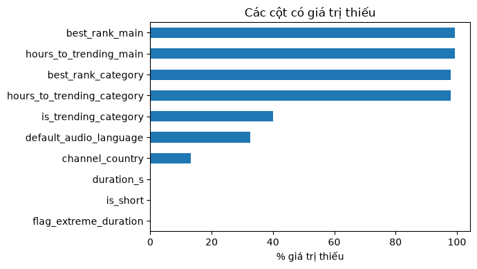

| Cột | Vì sao thiếu | Xử lý |
|---|---|---|
| `hours_to_trending_*`, `best_rank_*` | Chỉ có giá trị khi video lên trending | Bình thường; chỉ dùng khi mô tả video trending |
| `is_trending_category` (40,1%) | Video ra mắt trước khi chart danh mục được theo dõi đủ 72 giờ (job bắt đầu 09/10): **không biết**, không phải 0 | Nhãn danh mục chỉ phân tích trên tập sạch riêng |
| `default_audio_language` (32,6%), `channel_country` (13,2%) | Chủ kênh không khai báo | Không dùng làm biến chính |
| `duration_s` (0,02%) | Livestream chưa kết thúc | Gắn cờ `flag_no_duration` |

Không cột nào dùng cho câu hỏi chính (khung giờ, nhãn, danh mục, quy mô kênh, thời lượng) bị thiếu trong tập sạch; không cần điền giá trị.

### Ngoại lai

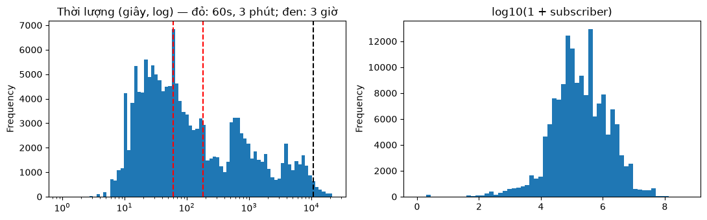

- **Thời lượng** lệch phải rất mạnh và nhiều đỉnh: đỉnh nhọn tại 60 giây (giới hạn Shorts cũ), đỉnh nhỏ tại 3 phút (giới hạn hiện tại), một cụm 10–15 phút và một đuôi dài là bản ghi livestream. 1.912 video dài hơn 3 giờ bị gắn cờ `flag_extreme_duration`; 205 video không có thời lượng bị gắn cờ `flag_no_duration`. Các phần sau dùng **nhóm thời lượng** thay vì số giây.
- **Subscriber** trải từ vài trăm tới hàng trăm triệu; dùng `log10_subs` hoặc nhóm `subs_group`. Kênh ẩn subscriber bị gắn cờ `flag_hidden_subs` (hiện 0 video trong cohort).

### Vấn đề lớn nhất: nhãn 0 sai do crawler vắng mặt

Crawler chạy trên máy cá nhân nên chỉ có mặt **412 trên 704 giờ** (58,5%), với 21 khoảng gián đoạn trên 3 giờ, dài nhất 94 giờ. Video lên chart đúng lúc crawler tắt bị ghi nhãn 0 dù thực ra đã trending.

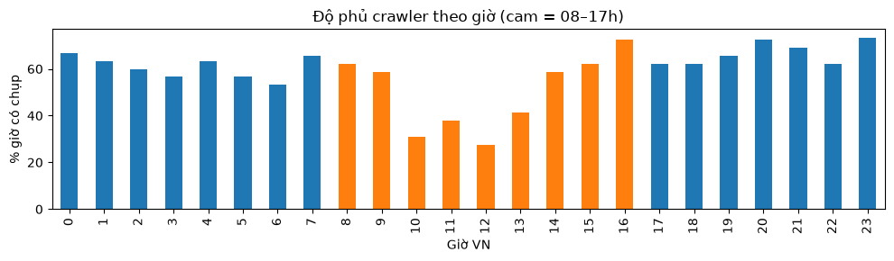

Ba bằng chứng cho thấy đây là vấn đề thật, không phải lo xa:

- Độ phủ **thấp nhất lúc 10–13h**, nằm trong giờ hành chính. Vì vậy so sánh thô thiên vị **bất lợi** cho giờ hành chính.
- Video mất dưới 12 giờ quan sát trong cửa sổ 72 giờ có tỉ lệ trending **1,38%**, so với **0,66%** ở video mất từ 12 giờ trở lên: nhãn của nhóm sau bị kéo xuống bởi nhãn 0 sai.
- Video trending ở lại chart trung vị 55 giờ nhưng 10% chỉ ở lại 6 giờ: gián đoạn dài chắc chắn làm sót.

**Cách giải: đo độ phủ cho từng video.** `coverage_24h` và `coverage_72h` = tỉ lệ số giờ có lần chụp chart chính trong 24 và 72 giờ đầu sau `release_at`. Một cách khác đã thử và bỏ: gắn cờ cho video có cửa sổ 72 giờ chạm một khoảng gián đoạn trên 3 giờ; cờ này dính toàn bộ cohort nên vô dụng.

**Chọn ngưỡng bằng bảng độ nhạy** (giữ các cờ khác, chỉ đổi ngưỡng):

| Ngưỡng độ phủ | Số video | Trending chính | % giờ hành chính | % giờ nghỉ | Nghỉ / hành chính |
|---:|---:|---:|---:|---:|---:|
| 0 | 154.194 | 885 | 0,322 | 0,699 | 2,17 |
| 0,4 | 98.434 | 704 | 0,402 | 0,904 | 2,25 |
| 0,5 | 77.895 | 622 | 0,452 | 0,986 | 2,18 |
| **0,6** | **40.531** | **398** | **0,617** | **1,180** | **1,91** |
| 0,7 | 20.586 | 276 | 0,853 | 1,730 | 2,03 |

Ngưỡng cao làm **số** nhãn 1 giảm (video trending rơi vào giai đoạn crawler vắng cũng bị loại) nhưng **tỉ lệ** tăng (nhãn 0 sai bị loại nhiều hơn). Chênh lệch nghỉ / hành chính khoảng 2 lần ở mọi ngưỡng, nên kết luận không phụ thuộc ngưỡng. Nhóm chọn **0,6** để cân bằng giữa độ tin cậy của nhãn và cỡ mẫu (0,8 chỉ còn khoảng 190 positive). Đây là ngưỡng chọn theo kinh nghiệm, được bảo vệ bằng bảng độ nhạy, không phải ngưỡng tối ưu theo công thức.

**Chart danh mục cần độ phủ riêng.** Job `trending_category` chạy mỗi 3 giờ từ 09/10, chỉ 52 lần chụp trong 15 ngày, 9 lần chụp dở dang (1–5 danh mục thay vì 12). Nếu lọc theo độ phủ của chart chính, nhãn danh mục bị mất gần hết. Nhóm đếm theo **ô 3 giờ** kể từ `release_at` (`coverage_cat_24h` = số ô có chụp / 8, `coverage_cat_72h` = / 24), chỉ tính lần chụp có đúng danh mục của video, và chọn ngưỡng **0,3** vì tỉ lệ trending danh mục đi ngang (3,2–3,5%) từ độ phủ khoảng 0,2 trở lên, nghĩa là nhãn 0 đã đáng tin:

| Độ phủ danh mục 72h | Số video | Tỉ lệ trending danh mục |
|---|---:|---:|
| 0–0,08 | 20.302 | 1,11% |
| 0,13–0,17 | 11.872 | 2,12% |
| 0,21–0,29 | 10.175 | 3,17% |
| 0,33–0,38 | 2.734 | 3,55% |
| 0,42–0,50 | 37.113 | 3,35% |
| 0,54–0,58 | 9.452 | 3,00% |

### Cờ làm sạch và hai tập sạch

| Cờ | Điều kiện | Số video |
|---|---|---:|
| `flag_no_duration` | Thời lượng rỗng hoặc 0 giây (livestream chưa kết thúc) | 205 |
| `flag_hidden_subs` | Kênh ẩn số subscriber | 0 |
| `flag_extreme_duration` | Thời lượng trên 3 giờ | 1.912 |
| `flag_low_coverage` | `coverage_24h` hoặc `coverage_72h` dưới 0,6 | 115.009 |
| `flag_low_coverage_cat` | `coverage_cat_24h` hoặc `coverage_cat_72h` dưới 0,3 | 112.553 |

| Tập sạch | Điều kiện | Khung giờ | Số video | Nhãn 1 | Tỉ lệ |
|---|---|---|---:|---:|---:|
| `is_clean` (nhãn chính) | Không dính 3 cờ đầu và `flag_low_coverage` | Hành chính | 14.253 | 88 | 0,617% |
| | | Nghỉ | 26.278 | 310 | 1,180% |
| | | **Tổng** | **40.531** | **398** | 0,982% |
| `is_clean_category` (nhãn danh mục) | Có nhãn danh mục, không dính 3 cờ đầu và `flag_low_coverage_cat` | Hành chính | 11.736 | 351 | 2,991% |
| | | Nghỉ | 27.933 | 932 | 3,337% |
| | | **Tổng** | **39.669** | **1.283** | 3,234% |

Phễu của nhãn chính: 156.311 → 154.194 (qua cờ thời lượng, subscriber; chỉ mất 1,4%) → **40.531** (26%). Gần như toàn bộ phần mất là do độ phủ. Tỉ lệ trending tăng từ 0,57% lên 0,98% khi lọc, đúng như dự kiến: video bị loại mang nhiều nhãn 0 sai. Hai tập sạch chỉ trùng 14.765 video, nên mỗi nhãn được phân tích trên tập sạch của chính nó.

### Kiểm tra chất lượng bằng SQL

`configs/checks.sql` (14 nhóm, output ở `reports/report2_sql_checks_output.txt`): 0 trùng khoá, 0 vi phạm khoá ngoại; chỉ `duration_s` thiếu ở livestream; 1,75% cặp lần chụp liên tiếp có view giảm (YouTube lọc view ảo, ghi nhận không sửa); khoảng trống giữa các lần chụp chart trung vị 1 giờ, dài nhất 94 giờ. Chi tiết ở Report 2, mục 7.

## Phân tích khám phá bằng RStudio (`notebooks/3_EDA.Rmd`)

### Cách đọc kết quả

- **Tỉ lệ trending** = số video lên chart trong 72 giờ / số video, tính trên tập sạch của từng nhãn. Mọi tỉ lệ kèm **khoảng tin cậy 95% Wilson** (thanh dọc hoặc ngang trên hình).
- **Tỉ số nghỉ / hành chính**: 1 = không khác biệt. Tỉ số sau kiểm soát dùng **Mantel–Haenszel**: so hai khung giờ trong từng nhóm video giống nhau về một yếu tố rồi gộp lại; khoảng tin cậy bằng **bootstrap theo kênh** (lấy mẫu lại kênh 300 lần), vì video cùng kênh không độc lập.
- Không làm kiểm định p-value: mục tiêu là đo **độ lớn** chênh lệch và độ bất định của nó. Report 4 kiểm tra lại bằng mô hình.
- Chạy lại: mở `notebooks/3_EDA.Rmd` trong RStudio (`http://localhost:8787`) và bấm Knit, khoảng 1 phút.

### A. Tập sạch có còn đại diện cho cohort không

Lọc độ phủ chỉ giữ khoảng một phần tư cohort. Nếu bộ lọc giữ lại video theo một kiểu nhất định, kết luận trên tập sạch sẽ không áp dụng được cho cohort.

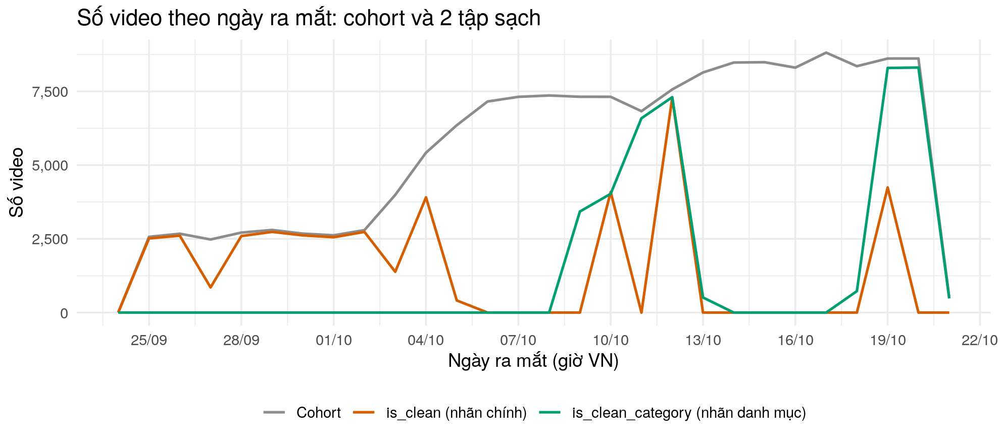

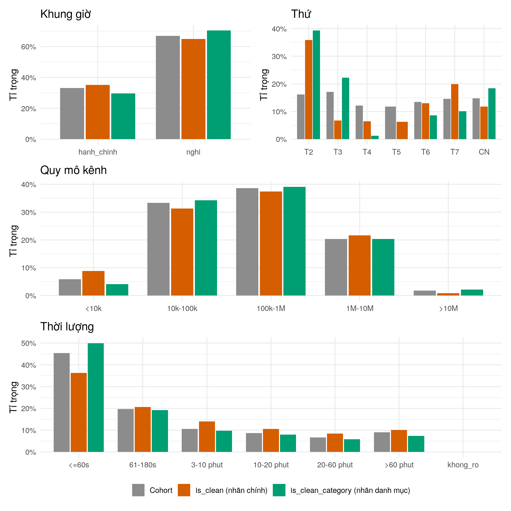

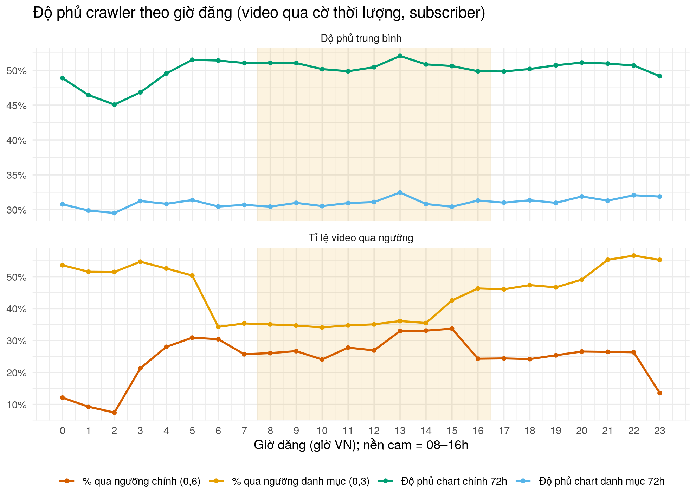

- **Không lệch khung giờ:** giờ hành chính chiếm 33,1% cohort, 35,2% `is_clean`, 29,6% `is_clean_category`. Tỉ lệ video qua ngưỡng độ phủ: 27,9% với video đăng giờ hành chính, 25,5% với giờ nghỉ; nhãn danh mục 42,9% ở cả hai. Độ phủ trung bình gần như phẳng theo giờ đăng (0,45–0,52) vì cửa sổ 72 giờ của mỗi video trải qua mọi giờ trong ngày. Bộ lọc **không thiên vị** khung giờ nào.
- **Lệch mạnh theo ngày:** `is_clean` chỉ đến từ **14 ngày** ra mắt (25/09–05/10 và 10/10, 12/10, 19/10), vì crawler vắng dài ngay sau các ngày còn lại. 12/10 và 19/10 đều là thứ 2, nên thứ 2 chiếm 36% `is_clean` (cohort 16%) và 39% `is_clean_category`.
- **Theo thời lượng:** Shorts chiếm 57% `is_clean` so với 65% cohort, vì tập sạch nặng về đợt đầu, mà đợt đầu ít Shorts hơn. Quy mô kênh lệch không quá 3 điểm phần trăm.

Hệ quả: các phần sau phải **kiểm soát ngày đăng**, vì giờ hành chính chỉ có ở thứ 2–6 và tỉ lệ nền thay đổi theo ngày.

### B. Phân phối từng biến

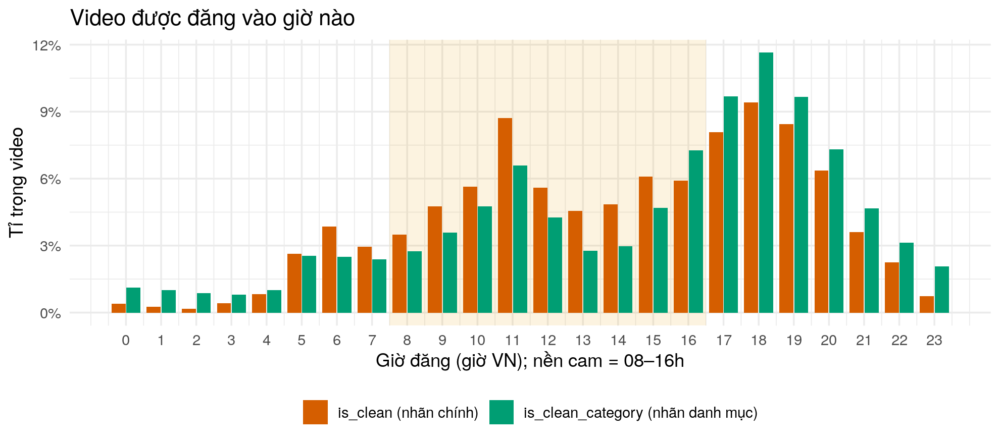

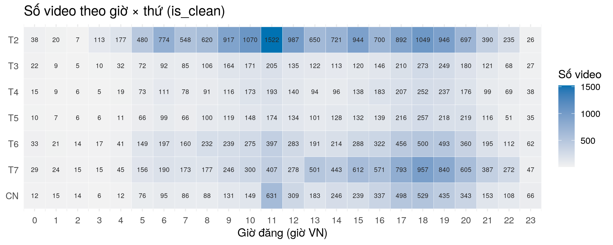

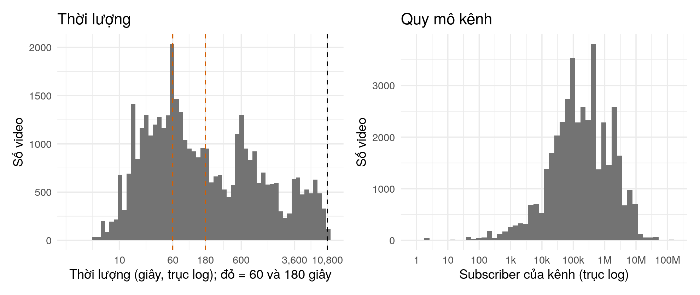

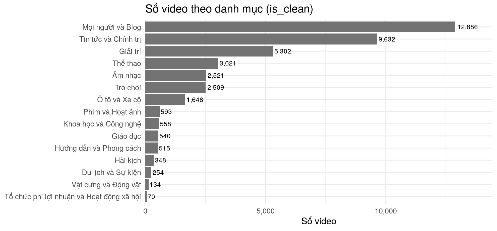

- Video đăng nhiều nhất lúc **17–19h** (26%) và **11h** (8,7%); rất ít video đăng 0–4h. Bốn đoạn thời gian: giờ hành chính 35,2%, cuối tuần 31,7%, tối ngày thường 24,0%, đêm và sáng sớm ngày thường 9,1%; mỗi đoạn có hàng nghìn video. Ô thứ 2 lúc 11h có 1.522 video, chủ yếu từ 12/10 và 19/10, rải trên nhiều kênh.
- Thời lượng trung vị 118 giây; 57% là Shorts (≤ 3 phút), riêng video ≤ 60 giây chiếm 36%. Subscriber trung vị 184.000. 3.356 kênh, trung vị 5 video mỗi kênh, nhưng **10 kênh đăng nhiều nhất chiếm 12,4% video** (kênh nhiều nhất 909 video), hầu hết là kênh Tin tức: phần D4 kiểm tra xem vài kênh này có tạo ra "hiệu ứng khung giờ" giả không.
- Ba danh mục lớn nhất (Mọi người và Blog, Tin tức và Chính trị, Giải trí) chiếm 69% video. Danh mục dưới 600 video được gộp thành "Khác" khi tính tỉ lệ. HD chiếm 99,5%, phụ đề 0,6%: hai biến này gần như hằng số, bỏ. Livestream và premiere chiếm 9,9%. 88% video khai báo âm thanh tiếng Việt, 93% kênh khai báo quốc gia VN.

### C. Tỉ lệ trending theo thời điểm đăng

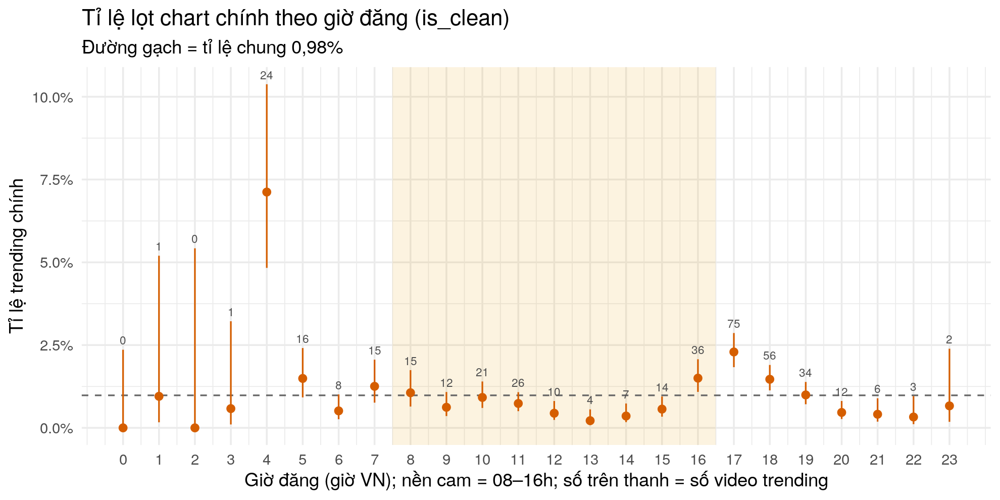

- **Đỉnh rõ nhất là 16–18h:** 17h đạt 2,3% (75 video trending), gấp hơn 2 lần tỉ lệ chung. Các giờ 9–15h đều dưới tỉ lệ chung, thấp nhất 13h (0,2%).
- 4h có 7,1% nhưng chỉ dựa trên 337 video; 14 trong 24 video trending đến từ 2 kênh (một kênh Mọi người và Blog, một kênh Âm nhạc), cả 24 đều là livestream: hiệu ứng của vài kênh, không phải của giờ đăng. 0–3h và 22–23h có quá ít video, không kết luận được.

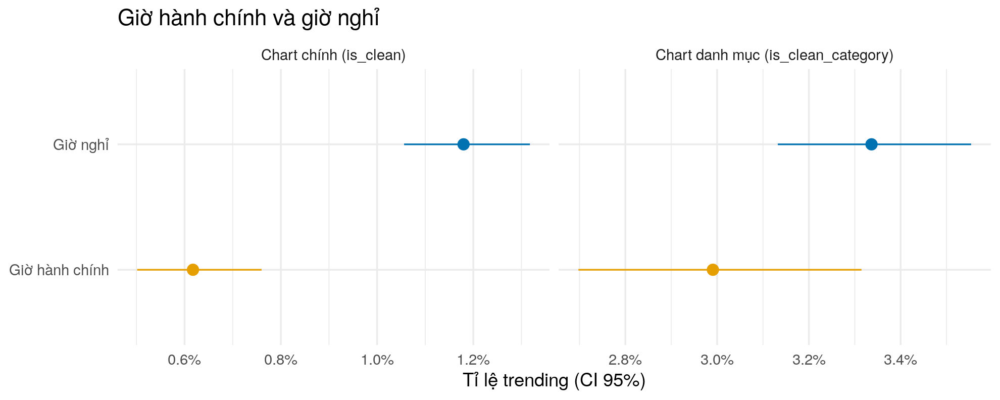

| Chart | Hành chính | Nghỉ | Nghỉ / hành chính |
|---|---|---|---:|
| Chính (`is_clean`) | 0,62% (88 / 14.253; CI 0,50–0,76) | 1,18% (310 / 26.278; CI 1,06–1,32) | **1,91** |
| Danh mục (`is_clean_category`) | 2,99% (351 / 11.736; CI 2,70–3,31) | 3,34% (932 / 27.933; CI 3,13–3,55) | 1,12 |

Với chart chính, hai khoảng tin cậy không chồng nhau: chênh lệch lớn hơn nhiều so với độ nhiễu do cỡ mẫu. Với chart danh mục, hai khoảng tin cậy chồng nhau.

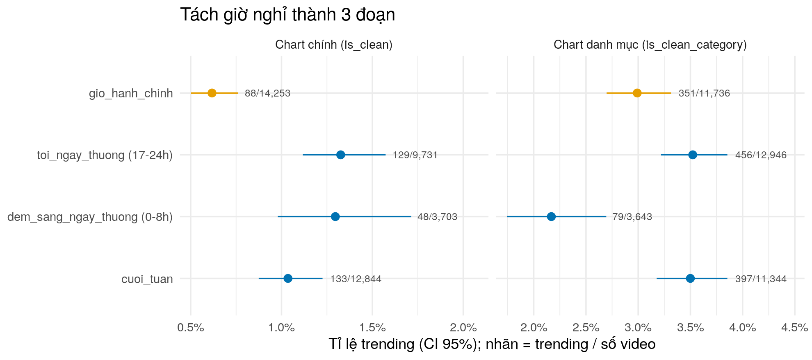

- Chart chính: cả ba đoạn giờ nghỉ đều cao hơn giờ hành chính. **Tối ngày thường (17–24h) cao nhất: 1,33%** (129 / 9.731), gấp 2,1 lần giờ hành chính dù cùng là thứ 2–6; đêm và sáng sớm 1,30%; cuối tuần thấp nhất trong giờ nghỉ (1,04%). Chênh lệch **không** đến từ cuối tuần.
- Chart danh mục: tối ngày thường 3,52% và cuối tuần 3,50% nhỉnh hơn giờ hành chính 2,99%; đêm và sáng sớm thấp nhất (2,17%).

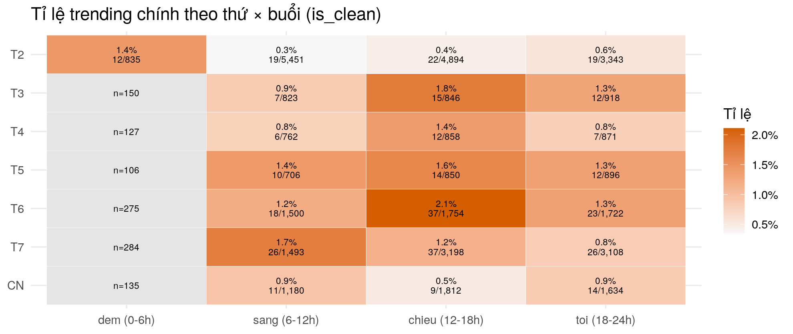

**Dữ liệu bất thường: tỉ lệ nền giảm theo ngày.** Thứ 2 thấp ở sáng, chiều, tối (0,35–0,57%) trong khi thứ 3–6 cao hơn hẳn. Lý do không nằm ở "thứ 2": tỉ lệ trending giảm mạnh theo ngày trong tập sạch, từ **1,32%** ở đợt 1 (25/09–05/10; 330 / 24.923) xuống **0,44%** ở đợt 2 (10, 12, 19/10; 68 / 15.608). Cách giải thích hợp lý nhất: chart chính chỉ có khoảng 200 chỗ mỗi lần chụp, còn số video mới mỗi ngày trong cohort tăng từ khoảng 2.700 lên 7.300–8.600 sau khi job `discover` mở rộng tập kênh. Hai ngày 12/10 và 19/10 là thứ 2 và chiếm **48% video giờ hành chính** trong tập sạch, nên kéo tỉ lệ giờ hành chính xuống.

Khi so trong cùng nhóm ngày, chênh lệch vẫn còn: trong thứ 2, giờ hành chính 0,31% so với tối 0,64% (gấp 2,1 lần); trong thứ 3–6, 1,03% so với 1,86% (gấp 1,8 lần). Mức tỉ lệ khác xa nhau giữa hai nhóm ngày, nhưng tối ngày thường vẫn gấp khoảng 2 lần giờ hành chính ở cả hai.

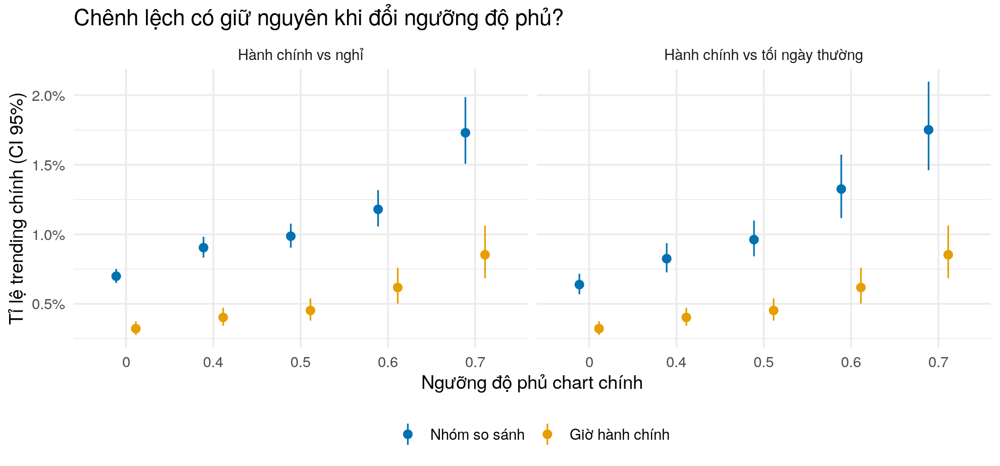

| Ngưỡng độ phủ | Nghỉ / hành chính | Tối ngày thường / hành chính |
|---:|---:|---:|
| 0 | 2,17 | 1,98 |
| 0,4 | 2,25 | 2,05 |
| 0,5 | 2,18 | 2,13 |
| **0,6** | **1,91** | **2,15** |
| 0,7 | 2,03 | 2,05 |

Ở mọi ngưỡng từ 0 tới 0,7, giờ nghỉ gấp 1,9–2,25 lần giờ hành chính. Ngưỡng làm thay đổi **mức** tỉ lệ (cao hơn khi lọc chặt, vì loại nhãn 0 sai) nhưng không làm thay đổi **chênh lệch**. Kết luận không phụ thuộc vào việc chọn ngưỡng 0,6.

### D. Kiểm soát nhiễu: chênh lệch có thật sự do giờ đăng

Chênh lệch ở phần C có thể đến từ yếu tố khác đi kèm giờ đăng: ngày đăng (tỉ lệ nền giảm theo thời gian), quy mô kênh, danh mục, thời lượng, hoặc vài kênh lớn.

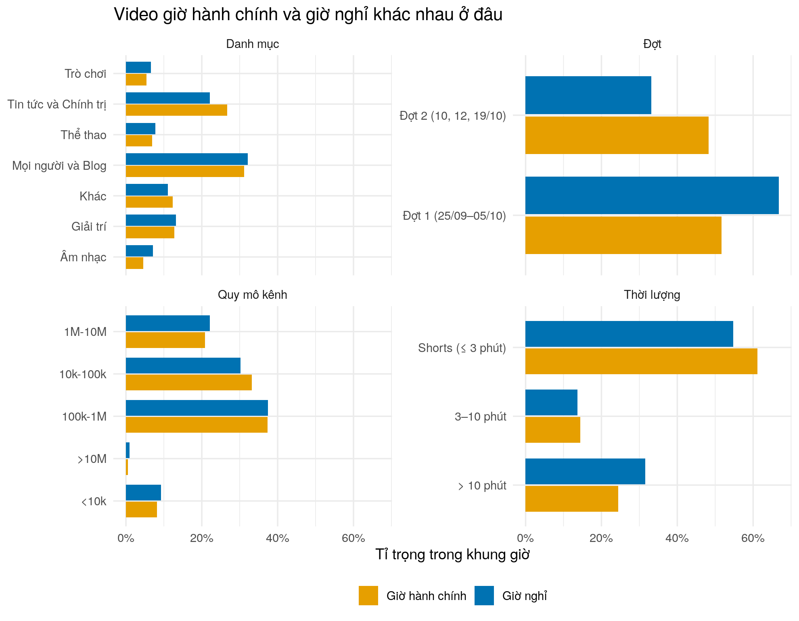

Hai khung giờ khác nhau ở những chỗ **đều bất lợi cho giờ hành chính**: chỉ 52% video giờ hành chính thuộc đợt 1 (tỉ lệ nền cao) so với 67% của giờ nghỉ; giờ hành chính có nhiều Tin tức hơn (27% so với 22%), nhiều Shorts hơn (61% so với 55%) và ít video dài trên 10 phút hơn (24,5% so với 31,5%). Quy mô kênh gần như giống nhau.

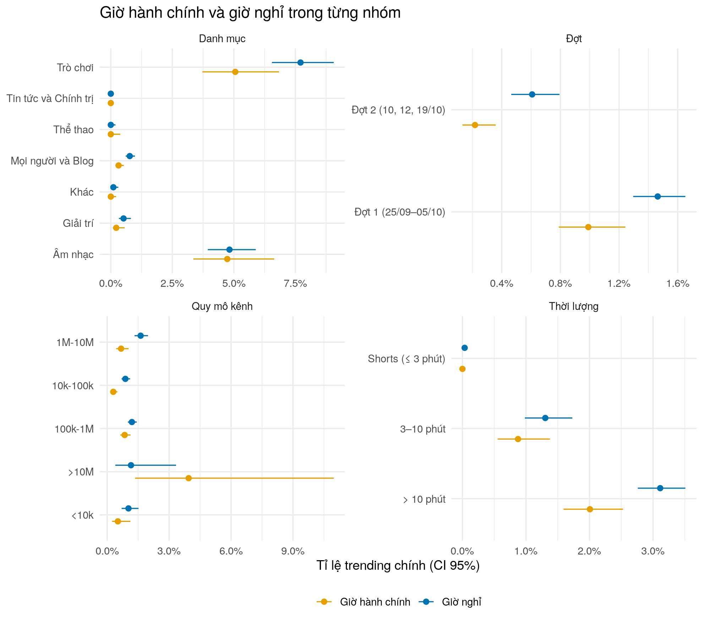

- **Phát hiện quan trọng nhất:** Tin tức và Chính trị (9.632 video) và Thể thao (3.021 video) có **0** video trending chính; Shorts (≤ 3 phút) có **5 trên 23.093**. Chart chính VN gần như không chứa các loại này, khớp với việc YouTube đổi định nghĩa chart `mostPopular` từ 07/2025 (chỉ lấy từ bảng Âm nhạc, Phim, Game). Video trending tập trung ở video dài trên 10 phút (328 / 398).
- Trong hầu hết các nhóm còn so sánh được, giờ nghỉ vẫn cao hơn: Mọi người và Blog 2,4 lần, Giải trí 2,4, Trò chơi 1,5; kênh 10k–100k 3,0, kênh 1M–10M 2,4, kênh 100k–1M 1,4; video 3–10 phút 1,5, trên 10 phút 1,55; đợt 1 1,5, đợt 2 2,8. Ngoại lệ: Âm nhạc không khác biệt (1,0).

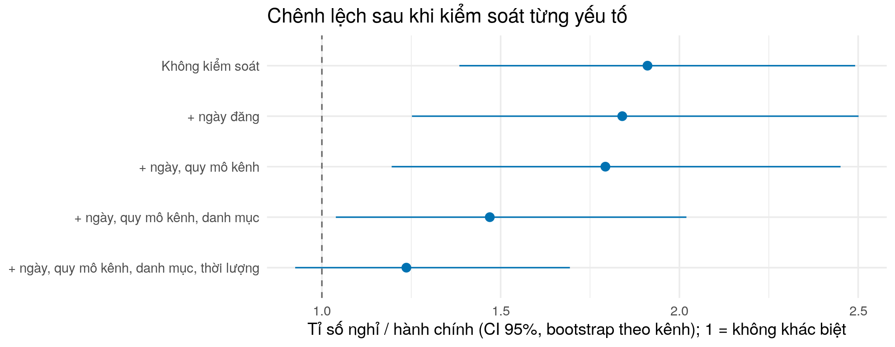

| Kiểm soát | Tỉ số nghỉ / hành chính (CI 95%) |
|---|---|
| Không kiểm soát | 1,91 (1,38–2,49) |
| + ngày đăng | 1,84 (1,25–2,50) |
| + ngày, quy mô kênh | 1,79 (1,20–2,45) |
| + ngày, quy mô kênh, danh mục | **1,47 (1,04–2,02)** |
| + ngày, quy mô kênh, danh mục, thời lượng | **1,24 (0,93–1,69)** |

Kiểm soát ngày đăng chỉ giữ các ngày có cả hai khung giờ (thứ 2–6, 27.273 video), nên giờ nghỉ thực chất là tối và đêm ngày thường. **Danh mục và thời lượng giải thích khoảng một nửa chênh lệch**; phần còn lại, khoảng 1,25–1,5 lần, vẫn nghiêng về giờ nghỉ nhưng khoảng tin cậy chạm 1 khi kiểm soát đủ. Khoảng tin cậy bootstrap theo kênh rộng hơn khoảng Wilson ở phần C, vì video cùng kênh có xu hướng cùng trending hoặc cùng không.

**Không do vài kênh lớn (D4).** 398 video trending đến từ 221 kênh; 10 kênh đầu chỉ chiếm 14,8%, mỗi kênh tối đa 8 video. Bỏ dần 5, 10, 20 kênh trending nhiều nhất, tỉ số (kiểm soát ngày và quy mô kênh) còn tăng nhẹ từ 1,79 lên 1,91.

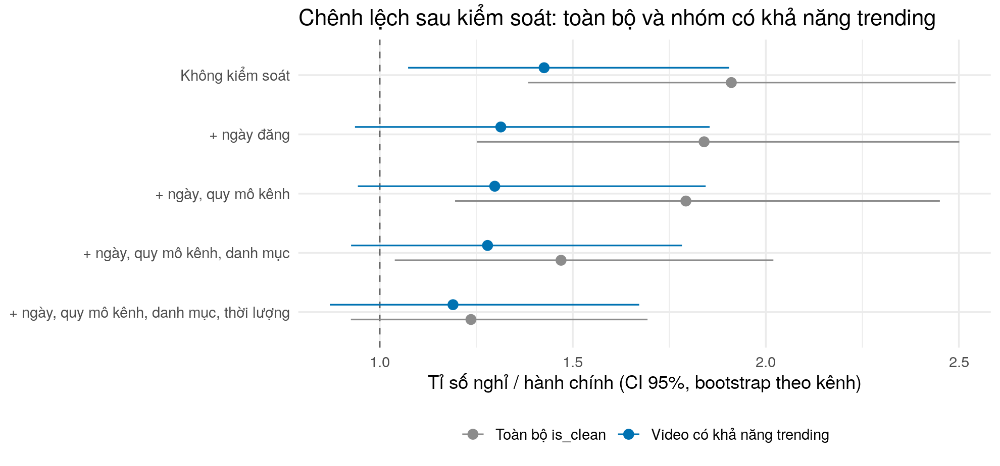

**Chỉ xét video có khả năng lên chart chính (D5).** Bỏ Shorts, Tin tức, Thể thao còn 10.231 video nhưng giữ 393 / 398 video trending; tỉ lệ nhãn tăng lên 3,8%. Giờ hành chính 2,95% (CI 2,40–3,62), giờ nghỉ 4,21% (CI 3,77–4,69), gấp 1,43 lần. Sau kiểm soát ngày, quy mô kênh, danh mục: 1,28 (CI 0,93–1,78); thêm thời lượng: 1,19 (CI 0,87–1,67). Trong nhóm này giờ nghỉ có 72% video dài trên 10 phút, giờ hành chính 63%; ngay trong cùng nhóm thời lượng, giờ nghỉ vẫn cao hơn (video dài 4,95% so với 3,71%). Nhóm này là **tập mô hình chính của Report 4**.

### E. Chân dung video trending

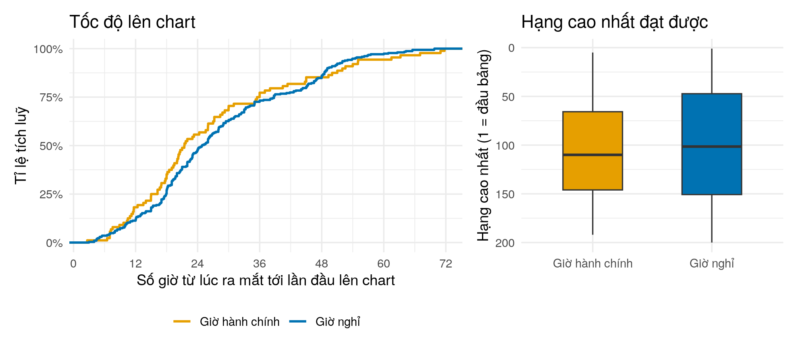

- Video đăng giờ hành chính lên chart nhanh hơn một chút (trung vị 21,4 giờ so với 24,9 giờ; 56% lên chart trong 24 giờ đầu so với 48%); hạng cao nhất gần như giống nhau (trung vị 110 so với 101,5); tỉ lệ vào top 50 là 20% so với 27%. Giờ đăng ảnh hưởng tới **có lọt chart hay không**, ít ảnh hưởng tới tốc độ hay thứ hạng khi đã lọt. Nhóm giờ hành chính chỉ có 88 video nên các chênh lệch nhỏ ở đây không chắc chắn.

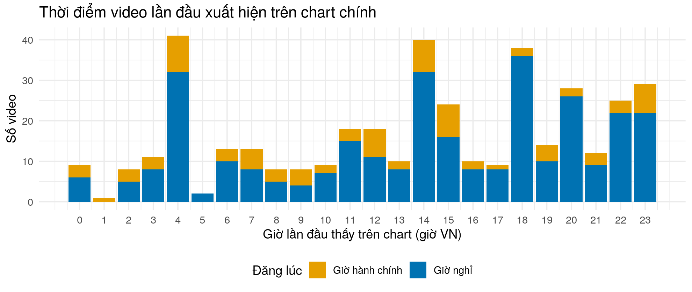

- Video lần đầu được thấy trên chart dồn vào 4h, 14h, 18h và rải đều tối 20–23h. Không tách được đây là nhịp cập nhật chart của YouTube hay do crawler bắt bù sau khi tắt, nên **không dùng hình này để chọn giờ đăng**.

| Đặc điểm | Video trending (398) | Video thường (40.133) |
|---|---:|---:|
| Thời lượng trung vị | 22,4 phút | 1,9 phút |
| Dài trên 10 phút | 82% | 29% |
| Shorts (≤ 3 phút) | 1,3% | 57,5% |
| Tin tức, Thể thao | 0% | 31,5% |
| Trò chơi, Âm nhạc | 74% | 12% |
| Livestream, premiere | 21% | 10% |
| Subscriber trung vị của kênh | 360.000 | 184.000 |
| Đăng giờ hành chính | 22% | 35% |

Video trending có chân dung rất khác video thường, rõ hơn nhiều so với khác biệt về giờ đăng.

### F. Nhãn chart danh mục

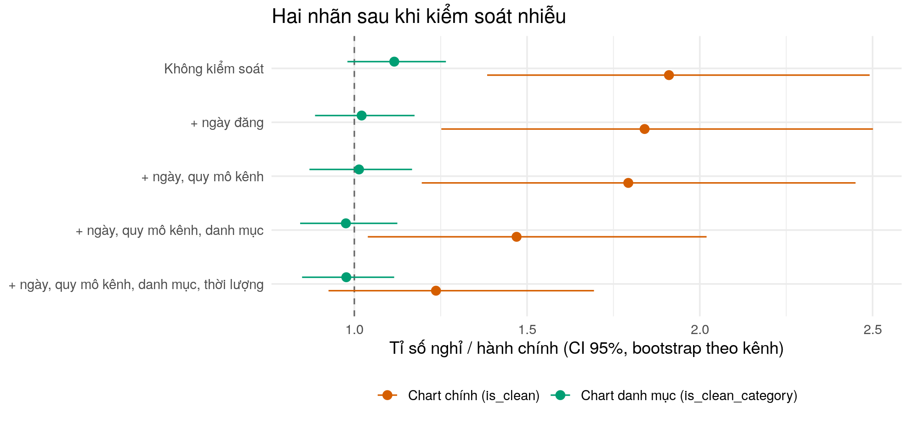

- Chart danh mục chọn video **ngược với chart chính**: Shorts có tỉ lệ cao nhất (3,74%, so với 2,59% ở video trên 10 phút và 1,04% ở video 3–10 phút); Tin tức và Thể thao vẫn lọt được (1,3% và 3,6%).
- Tỉ số nghỉ / hành chính chỉ 1,12 khi chưa kiểm soát (CI 0,98–1,27), về 1,02 (CI 0,89–1,17) khi kiểm soát ngày đăng, và 0,98 (CI 0,85–1,12) khi kiểm soát đủ bốn yếu tố. **Với chart danh mục, giờ đăng không tạo khác biệt**; chênh lệch nhỏ ở phần C đến từ ngày đăng.

### Kết luận của EDA

| Bằng chứng | Chart chính: nghỉ / hành chính | Chart danh mục: nghỉ / hành chính |
|---|---|---|
| Tỉ lệ thô (C2) | 1,91 (CI 1,38–2,49) | 1,12 (CI 0,98–1,27) |
| Cùng nhóm ngày, so với tối ngày thường (C4) | 1,8–2,1 | — |
| Đổi ngưỡng độ phủ 0–0,7 (C5) | 1,9–2,25 | — |
| Kiểm soát ngày, quy mô kênh, danh mục (D3) | 1,47 (CI 1,04–2,02) | 0,98 (CI 0,84–1,12) |
| Thêm thời lượng (D3) | 1,24 (CI 0,93–1,69) | 0,98 (CI 0,85–1,12) |
| Bỏ 20 kênh trending nhiều nhất (D4) | 1,91 | — |
| Chỉ video có khả năng trending, kiểm soát ngày, kênh, danh mục (D5) | 1,28 (CI 0,93–1,78) | — |

1. **Chart chính:** video đăng ngoài giờ hành chính dễ lọt trending hơn, rõ nhất khi đăng chiều tối ngày thường (16–18h). Chênh lệch thô gần 2 lần, nhưng phần lớn đến từ loại video đăng vào mỗi khung giờ. Sau khi kiểm soát ngày đăng, quy mô kênh và danh mục, lợi thế còn khoảng 1,5 lần (khoảng tin cậy vẫn trên 1); kiểm soát thêm thời lượng, hoặc chỉ xét video có khả năng trending, còn khoảng 1,2–1,3 lần và không còn chắc chắn.
2. **Chart danh mục:** không có khác biệt theo giờ đăng sau khi kiểm soát.
3. **Loại video quan trọng hơn giờ đăng nhiều:** chart chính gần như chỉ chứa video dài, không Shorts, không Tin tức, Thể thao; Trò chơi và Âm nhạc chiếm 74%. Đăng đúng giờ không bù được cho việc video không thuộc loại mà chart chính chọn.

**Giới hạn.** Crawler chỉ có mặt 58,5% số giờ (xử lý bằng độ phủ và bảng độ nhạy). Tập sạch đến từ 14 ngày, nặng về thứ 2 (kiểm soát ngày đăng). Tỉ lệ nền giảm theo thời gian (so trong cùng ngày). Chỉ các kênh đang theo dõi, không phải mọi video Việt Nam. `channel_subscribers` lấy tại lần chụp mới nhất. Shorts ước lượng theo thời lượng. Video cùng kênh không độc lập (bootstrap theo kênh). Đây là dữ liệu quan sát: chỉ nói được giờ nghỉ **đi kèm** tỉ lệ trending cao hơn, không chứng minh được giờ đăng **gây ra** trending.

**Chuyển sang Report 4.** Dùng nhãn `is_trending_main` trên tập `is_clean`, bỏ Shorts, Tin tức, Thể thao; đưa loại video và ngày đăng vào làm feature; khoảng 1–4% nhãn 1 nên dùng trọng số lớp và đánh giá bằng PR-AUC; chia train và test theo kênh; so hệ số và độ quan trọng của khung giờ khi có và không có feature loại video.

## Data dictionary

Từ điển dữ liệu đầy đủ nằm ở `reports/data_dictionary.md` và được chép nguyên văn ở Phụ lục A: 9 bảng gốc (cột, kiểu, ý nghĩa), 5 view trung gian, và 47 cột của bảng phân tích `v_video_features` (kiểu, cách tính, khi nào `NULL`, giá trị tại mốc 01/11).

## Phụ lục A — Data dictionary (chép từ `reports/data_dictionary.md`)

Mốc số liệu: **01/11/2026**. Dữ liệu thu thập từ 24/09 đến lần chụp cuối 24/10/2026 (giờ VN), không crawl thêm.

```
YouTube Data API ─► MinIO (raw JSON) ─► PostgreSQL: 9 bảng gốc ─► view trung gian ─► v_video_features ─► EDA / mô hình
                    src/ingestion/       configs/schema.sql          configs/labels.sql    configs/features.sql
```

- **Bảng gốc** chứa dữ liệu đã chuẩn hoá kiểu, không bị xoá hay lọc. Mọi lựa chọn (bỏ backfill, cohort, nhãn, cờ làm sạch) nằm ở **view**.
- **Bảng phân tích** là `v_video_features`, đóng băng ra `data/processed/video_features_full_2026-11-01.csv` (156.311 dòng, 47 cột; không commit, repo chỉ có mẫu 500 dòng `video_features_sample.csv`).
- **Thời gian**: cột `TIMESTAMPTZ` lưu theo UTC. Cột có hậu tố `_vn` là giờ Việt Nam (`Asia/Ho_Chi_Minh`, UTC+7).
- **`region_code`** = khu vực của **máy crawl** đã thu thập dòng đó (VN / JP / US), gán theo `crawler_id` trong `configs/db_config.json`. **Không phải** quốc gia của kênh (xem `channels.country`). Mọi view phân tích chỉ dùng `VN`.


### Bảng gốc (9 bảng)

#### `raw_files` — nhật ký file raw đã nạp (241.202 dòng)
| Cột | Kiểu | Ý nghĩa |
|---|---|---|
| `object_key` (PK) | TEXT | Tên object trên MinIO: `raw/youtube/<job>/dt=<ngày>/<crawler_id>_<HHMMSS>_pNN.json` |
| `job`, `endpoint` | TEXT | Job crawl (`trending`, `uploads/videos`, ...) và endpoint API đã gọi |
| `crawler_id` | TEXT | Máy crawl (VN: `t1-2rban`, `t1-2rbannnz`; JP: `duc`; US: `phat`) |
| `captured_at` / `crawl_time_utc` | TIMESTAMPTZ | Mốc chụp lấy từ tên file (lúc bắt đầu lượt chạy) / lúc thật sự gọi API |
| `page_index`, `n_items` | INT | Trang thứ mấy của lượt chạy, số item trong file |

Bằng chứng dữ liệu đi từ MinIO vào DB; loader bỏ qua file đã có ở đây nên chạy lại không nạp trùng.

#### `categories` — danh mục video (32 dòng)
| Cột | Kiểu | Ý nghĩa |
|---|---|---|
| `category_id` (PK) | INT | Mã danh mục YouTube |
| `title` | TEXT | Tên danh mục tiếng Việt (`videoCategories.list`, `hl=vi`) |
| `assignable` | BOOLEAN | Danh mục có gán được cho video không |

Danh mục 29 không có trong API khu vực VN nhưng có video dùng, nên được thêm sẵn. Mã lạ khác được thêm thành dòng tạm (`title` NULL).

#### `channels` — kênh, bản mới nhất (19.219 dòng)
| Cột | Kiểu | Ý nghĩa |
|---|---|---|
| `channel_id` (PK) | TEXT | Mã kênh |
| `title`, `custom_url`, `country`, `default_language` | TEXT | Thông tin kênh; `country` NULL nếu kênh không khai báo |
| `subscriber_count`, `video_count`, `view_count` | BIGINT | Số liệu kênh **tại lần chụp mới nhất**; subscriber NULL nếu kênh ẩn |
| `hidden_subscriber` | BOOLEAN | Kênh ẩn số subscriber |
| `uploads_playlist` | TEXT | Playlist "uploads" của kênh, job `uploads` đọc để tìm video mới |
| `first_seen_at`, `last_seen_at`, `first_source_job` | | Lần đầu / lần cuối thấy kênh và job đã thấy đầu tiên |
| `is_stub` | BOOLEAN | Kênh **tạm** (68 kênh): video đến trước kênh, chỉ có `channel_id`, chờ `channels.list` điền đủ |

#### `videos` — metadata video, bản mới nhất (439.870 dòng)
| Cột | Kiểu | Ý nghĩa |
|---|---|---|
| `video_id` (PK) | TEXT | Mã video |
| `channel_id` (FK → `channels`), `category_id` (FK → `categories`) | TEXT / INT | Kênh và danh mục |
| `published_at` | TIMESTAMPTZ | `snippet.publishedAt`; với livestream YouTube đổi thành lúc phát **xong** |
| `actual_start_time`, `scheduled_start_time` | TIMESTAMPTZ | Lúc bắt đầu phát thật / dự kiến (chỉ livestream, premiere) |
| `title`, `description`, `tags` (TEXT[]), `default_language`, `default_audio_language` | | Nội dung do chủ kênh khai báo |
| `duration_s` | INT | Thời lượng (giây), đổi từ ISO 8601 `PT4M13S`; NULL hoặc 0 khi livestream chưa kết thúc |
| `definition`, `caption`, `live_broadcast_content` | TEXT / BOOLEAN / TEXT | `hd`/`sd`; có phụ đề; `none`/`live`/`upcoming` |
| `first_seen_at`, `last_seen_at`, `first_source_job` | | Lần đầu / lần cuối thấy video, job đã thấy đầu tiên |

#### `video_sources` — video được job nào thấy (1.621.859 dòng)
| Cột | Kiểu | Ý nghĩa |
|---|---|---|
| `video_id` | TEXT | Mã video (không có FK: nhiều video chỉ có trong playlist, không có dòng `videos`) |
| `source_job` | TEXT | `trending`, `trending_category`, `uploads/videos`, `uploads/playlist_items`, `stats`, `backfill/videos`, `backfill/playlist_items` |
| `region_code` | TEXT | Khu vực máy crawl |
| `first_captured_at` | TIMESTAMPTZ | Lần đầu job đó thấy video |
| PK | | `(video_id, source_job, region_code)` |

Dùng để tách video mới (cohort, từ `uploads/videos` của VN) khỏi video lịch sử (backfill).

#### `video_stats` — số liệu tương tác tại mỗi lần chụp (2.723.654 dòng)
| Cột | Kiểu | Ý nghĩa |
|---|---|---|
| `video_id` (FK → `videos`) | TEXT | Mã video |
| `captured_at` | TIMESTAMPTZ | Mốc chụp |
| `source_job`, `region_code` | TEXT | Job và khu vực máy đã chụp |
| `view_count` | BIGINT | Số view tại mốc chụp |
| `like_count`, `comment_count` | BIGINT | NULL khi chủ kênh ẩn (không điền 0) |
| PK | | `(video_id, captured_at, source_job, region_code)` |

#### `trending_snapshots` — mỗi lần video có mặt trên bảng xếp hạng (180.459 dòng)
| Cột | Kiểu | Ý nghĩa |
|---|---|---|
| `video_id` (FK → `videos`) | TEXT | Mã video |
| `captured_at` | TIMESTAMPTZ | Mốc chụp của lượt chạy |
| `source` | TEXT | `main` = chart chính (job `trending`, mỗi giờ); `category` = chart theo danh mục (job `trending_category`, mỗi 3 giờ) |
| `category_id` | INT | 0 với chart chính; mã danh mục với chart danh mục |
| `page_index`, `position` | INT | Trang (50 video/trang) và vị trí trong trang; thứ hạng = `v_trending_rank.rank` |
| `region_code` | TEXT | Chart của khu vực nào |
| PK | | `(video_id, captured_at, source, category_id, region_code)` |

Nguồn của 2 nhãn trending.

#### `playlist_items` — danh sách video của kênh (7.967.633 dòng)
| Cột | Kiểu | Ý nghĩa |
|---|---|---|
| `video_id`, `playlist_id` | TEXT | Video nằm trong playlist uploads của kênh |
| `video_published_at` | TIMESTAMPTZ | Giờ đăng theo playlist |
| `captured_at`, `source_job` | | Mốc chụp, job (`uploads/playlist_items` hoặc `backfill/playlist_items`) |
| PK | | `(video_id, playlist_id, captured_at)` |

Bước trung gian để tìm video mới; không có FK vì phần lớn video cũ không được gọi `videos.list`.

#### `discover_candidates` — kênh ứng viên do `discover` tìm được (28.911 dòng)
| Cột | Kiểu | Ý nghĩa |
|---|---|---|
| `channel_id` | TEXT | Kênh ứng viên |
| `method` | TEXT | `search` (tìm theo từ khoá) hoặc `sections` (mục "kênh nổi bật" của kênh khác) |
| `query_or_parent` | TEXT | Từ khoá đã tìm, hoặc kênh cha |
| `captured_at` | TIMESTAMPTZ | Mốc chụp |
| PK | | `(channel_id, method, query_or_parent, captured_at)` |

Truy vết vì sao một kênh được đưa vào danh sách theo dõi.


### View trung gian (`configs/labels.sql`)

| View | Một dòng là | Vai trò |
|---|---|---|
| `v_videos_analysis` | 1 video | Video được máy VN thấy ở job không phải backfill, kênh không phải kênh tạm |
| `v_stats_analysis` | 1 lần chụp số liệu | `video_stats` của VN, bỏ backfill, chỉ video trong `v_videos_analysis` |
| `v_trending_rank` | 1 lần có mặt trên chart VN | Thêm `rank` liên tục (1 = cao nhất) trong từng lần chụp × chart × danh mục |
| `v_cohort` | 1 video | Video do `uploads/videos` của VN tìm thấy, ra mắt trong khoảng chart chính được theo dõi trọn 72 giờ (24/09 16:52 → 20/10 23:00 UTC) |
| `v_video_labels` | 1 video của cohort | Gắn 2 nhãn trending (cửa sổ 72 giờ) và biến cơ bản |


### Bảng phân tích `v_video_features` (156.311 dòng, 47 cột)

Một dòng = **một video trong cohort VN**. Cột "Giá trị (01/11)" lấy trên toàn bộ 156.311 dòng.

#### Định danh và thời gian

| Cột | Kiểu | Ý nghĩa / cách tính | NULL khi | Giá trị (01/11) |
|---|---|---|---|---|
| `video_id` | text | Mã video (khoá, không trùng) | Không | 156.311 video |
| `channel_id` | text | Mã kênh | Không | 3.824 kênh |
| `published_at` | timestamptz | `snippet.publishedAt` từ API | Không | |
| `release_at` | timestamptz | **Giờ ra mắt thật** = `COALESCE(actual_start_time, published_at)`; livestream dùng lúc bắt đầu phát | Không | Khác `published_at` ở 5.531 video |
| `release_at_vn` | timestamp | `release_at` theo giờ VN | Không | 24/09 23:53 → 21/10 06:00 |
| `publish_hour_vn` | integer | Giờ đăng theo giờ VN (0–23) | Không | Trung vị 15 |
| `publish_dow_vn` | integer | Thứ đăng theo giờ VN, ISO: 1 = thứ 2 … 7 = chủ nhật | Không | |

#### Nhãn trending (cửa sổ 72 giờ kể từ `release_at`)

| Cột | Kiểu | Ý nghĩa / cách tính | NULL khi | Giá trị (01/11) |
|---|---|---|---|---|
| `is_trending_main` | boolean | Có ít nhất một lần chụp **chart chính VN** trong `[release_at, release_at + 72h]` | Không bao giờ (cohort đã đảm bảo theo dõi trọn 72 giờ) | true: 1.029 (0,66%) |
| `hours_to_trending_main` | numeric | Số giờ từ `release_at` tới lần đầu lên chart chính | Video không trending chính | 2,3 → 71,8 giờ; trung vị 25,0 |
| `best_rank_main` | bigint | Thứ hạng cao nhất trên chart chính trong 72 giờ (1 = đầu bảng) | Video không trending chính | 1 → 200; trung vị 98 |
| `is_trending_category` | boolean | Có ít nhất một lần chụp **chart danh mục VN** trong 72 giờ | Video ra mắt ngoài khoảng chart danh mục được theo dõi đủ 72 giờ (job bắt đầu 09/10): **không biết**, không phải `false` | NULL 40,14%; true: 2.492 |
| `hours_to_trending_category` | numeric | Như trên, với chart danh mục | Video không trending danh mục | 2,5 → 71,9 giờ; trung vị 27,2 |
| `best_rank_category` | bigint | Thứ hạng cao nhất trên chart danh mục | Video không trending danh mục | 1 → 200; trung vị 75 |

#### Khung giờ đăng (biến chính của câu hỏi "thời điểm vàng")

| Cột | Kiểu | Ý nghĩa / cách tính | NULL khi | Giá trị |
|---|---|---|---|---|
| `is_office_hours` | boolean | Thứ 2–6 **và** giờ 8–16 (tức 08:00–16:59, giờ VN) | Không | true: 51.702 (33%) |
| `time_slot` | text | `hanh_chinh` nếu `is_office_hours`, ngược lại `nghi` | Không | 2 giá trị |
| `slot_detail` | text | Tách giờ nghỉ: `gio_hanh_chinh`, `cuoi_tuan` (thứ 7, CN), `toi_ngay_thuong (17-24h)`, `dem_sang_ngay_thuong (0-8h)` | Không | 4 giá trị |
| `day_part` | text | Buổi trong ngày: `dem (0-6h)`, `sang (6-12h)`, `chieu (12-18h)`, `toi (18-24h)` | Không | 4 giá trị |
| `is_weekend` | boolean | Thứ 7 hoặc chủ nhật (giờ VN) | Không | true: 45.883 |

#### Biến kiểm soát

| Cột | Kiểu | Ý nghĩa / cách tính | NULL khi | Giá trị |
|---|---|---|---|---|
| `category_id` | integer | Mã danh mục video | Không | 15 danh mục |
| `category_title` | text | Tên danh mục (từ `categories`) | Không | Nhiều nhất: Mọi người và Blog |
| `duration_s` | integer | Thời lượng (giây) | Livestream chưa có thời lượng (0,02%) | Trung vị 73 giây |
| `duration_group` | text | `<=60s`, `61-180s`, `3-10 phut`, `10-20 phut`, `20-60 phut`, `>60 phut`, `khong_ro` (NULL) | Không | 7 giá trị |
| `is_short` | boolean | `duration_s ≤ 180` | `duration_s` NULL | Shorts dài tối đa 3 phút từ 15/10/2024 (trước đó 60 giây). Ước lượng theo thời lượng: API không cho biết video dọc hay ngang |
| `live_broadcast_content` | text | Trạng thái phát lúc chụp cuối: `none`, `live`, `upcoming` | Không | |
| `is_live_or_premiere` | boolean | Có `actual_start_time` (livestream hoặc premiere đã phát) | Không | true: 13.369 |
| `definition` | text | `hd` / `sd` | Không | |
| `caption` | boolean | Có phụ đề do chủ kênh tải lên | Không | true: 846 |
| `default_audio_language` | text | Ngôn ngữ âm thanh do chủ kênh khai báo (`vi`, `en`, ...) | Chủ kênh không khai báo (32,56%) | 49 giá trị |
| `title_length` | integer | Số ký tự tiêu đề | Không | 1 → 100; trung vị 68 |
| `n_tags` | integer | Số tag (0 nếu không có) | Không | Trung vị 5 |
| `channel_subscribers` | bigint | Số subscriber của kênh **tại lần chụp kênh mới nhất**, không phải lúc đăng video | Kênh ẩn subscriber (hiện 0 video) | Trung vị 183.000 |
| `subs_group` | text | `<10k`, `10k-100k`, `100k-1M`, `1M-10M`, `>10M`; `an` nếu ẩn | Không | 5 giá trị có mặt |
| `log10_subs` | double | `log10(1 + channel_subscribers)` | Kênh ẩn subscriber | 0 → 8,7 |
| `channel_video_count`, `channel_view_count` | bigint | Số video, tổng view của kênh (lần chụp mới nhất) | Không | |
| `channel_country` | text | Quốc gia kênh tự khai báo | Kênh không khai báo (13,22%) | 55 giá trị; nhiều nhất VN |

#### Độ phủ crawler và cờ làm sạch

Cờ **không xoá dòng**, chỉ đánh dấu. Mỗi nhãn có một tập sạch riêng.

| Cột | Kiểu | Ý nghĩa / cách tính | NULL khi | Giá trị |
|---|---|---|---|---|
| `coverage_24h` | double | Tỉ lệ số giờ có lần chụp chart chính VN trong 24 giờ đầu (số giờ / 24) | Không | 0 → 1; trung vị 0,583 |
| `coverage_72h` | double | Như trên, trong 72 giờ đầu (/ 72). Giá trị nhỏ nhất 0,014 (= 1/72) thay vì 0 do cách đếm, không ảnh hưởng ngưỡng | Không | Trung vị 0,542; tối đa 0,917 |
| `coverage_cat_24h` | double | Tỉ lệ **ô 3 giờ** có lần chụp chart danh mục **đúng danh mục của video** trong 24 giờ đầu (/ 8) | Không | 0 → 0,875 |
| `coverage_cat_72h` | double | Như trên, trong 72 giờ đầu (/ 24) | Không | 0 → 0,708; trung vị 0,167 |
| `flag_no_duration` | boolean | `duration_s` NULL hoặc 0 (livestream chưa kết thúc) | Không | true: 205 |
| `flag_hidden_subs` | boolean | `channel_subscribers` NULL (kênh ẩn hoặc kênh tạm) | Không | true: 0 |
| `flag_extreme_duration` | boolean | `duration_s` > 3 giờ (chủ yếu bản ghi livestream dài) | `duration_s` NULL | true: 1.912 |
| `flag_low_coverage` | boolean | `coverage_24h` < 0,6 **hoặc** `coverage_72h` < 0,6 | Không | true: 115.009 |
| `flag_low_coverage_cat` | boolean | `coverage_cat_24h` < 0,3 **hoặc** `coverage_cat_72h` < 0,3 | Không | true: 112.553 |
| **`is_clean`** | boolean | **Tập sạch cho nhãn chính**: không dính `flag_no_duration`, `flag_hidden_subs`, `flag_extreme_duration`, `flag_low_coverage` | Không | **true: 40.531** (398 trending chính) |
| **`is_clean_category`** | boolean | **Tập sạch cho nhãn danh mục**: `is_trending_category` không NULL, không dính 3 cờ đầu và `flag_low_coverage_cat` | Không | **true: 39.669** (1.283 trending danh mục) |

**Vì sao cần độ phủ:** crawler chạy trên máy cá nhân, chỉ có mặt khoảng 59% số giờ. Video lên trending đúng lúc crawler tắt bị ghi nhãn 0 sai. Ngưỡng chọn bằng bảng độ nhạy (`notebooks/1_Exploration.ipynb` mục 6, 6b; `docs/analysis/02_cleaning.md` P15).


### Cách dùng

| Câu hỏi | Lọc | Nhãn |
|---|---|---|
| Đăng giờ nào dễ lọt **chart chính** | `WHERE is_clean` | `is_trending_main` |
| Đăng giờ nào dễ lọt **chart danh mục** | `WHERE is_clean_category` | `is_trending_category` |
| Mô tả video trending (nhanh/chậm, hạng) | Mọi video có nhãn 1, không cần tập sạch | `hours_to_trending_*`, `best_rank_*` |

