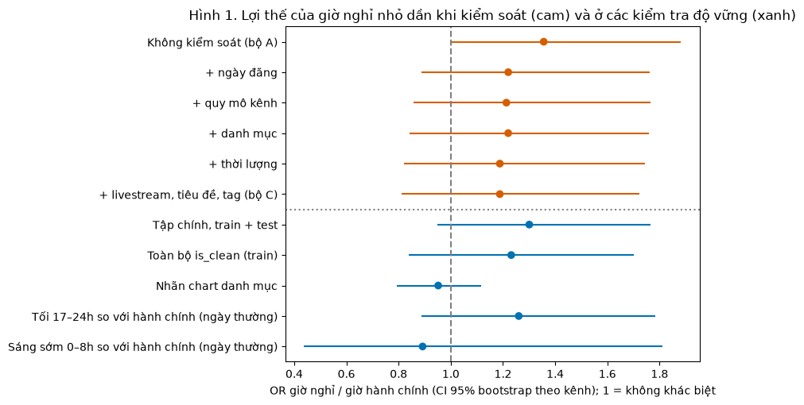
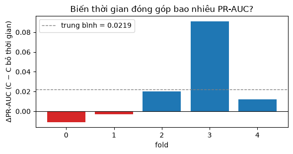
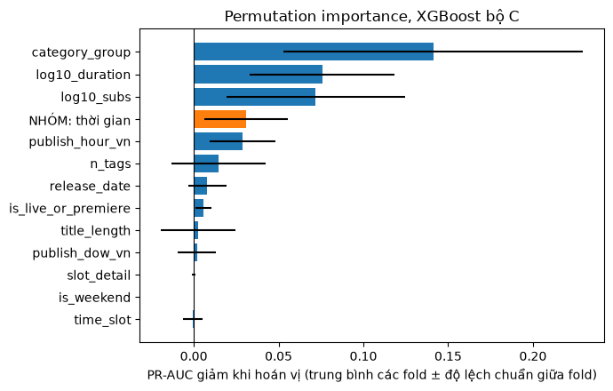
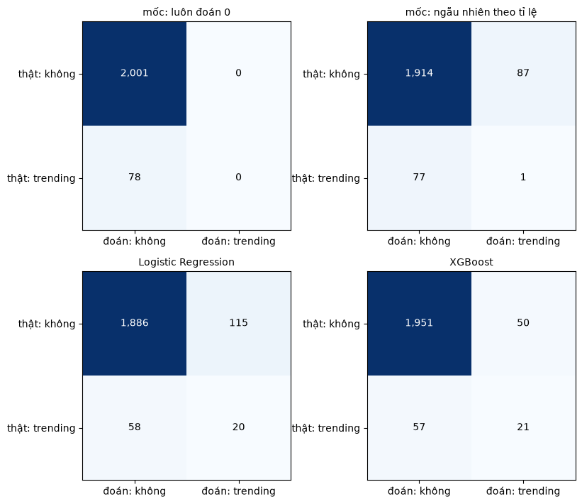
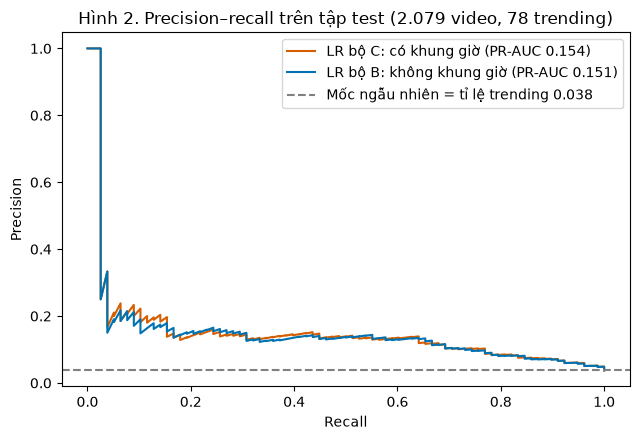

# Report 4 — Mô hình phân loại và kiểm định giả thuyết

ADY201m — AI, Data Science with Python &amp; SQL · FPT University

<h1>Thời điểm vàng trên YouTube Việt Nam: mô hình và kết luận về giả thuyết</h1>

Report 4 — Modeling &amp; Validation Đề tài 4: Trending Content (YouTube)

<table>
<tr><td>Nhóm</td><td>BanNH — QE210137 (quy tắc kiểm định, tách dữ liệu, Logistic Regression, kết luận) Lâm Duy Phát (XGBoost: huấn luyện và tinh chỉnh) Nguyễn Lê Minh Đức (XGBoost: giải thích, so sánh mô hình)</td></tr>
<tr><td>Mốc số liệu</td><td>Bản phân tích đóng băng 01/11/2026; mô hình chạy 14/11/2026</td></tr>
<tr><td>Sản phẩm</td><td><code>src/modeling/</code> · <code>notebooks/2_Modeling.ipynb</code>, <code>2_Modeling_phat_XGB.ipynb</code>, <code>2_Modeling_XGBoost.ipynb</code> · <code>docs/analysis/04_modeling.md</code></td></tr>
</table>

Báo cáo viết để đọc độc lập. Quy tắc chấp nhận hay bác bỏ giả thuyết được chốt trước khi chạy mô hình (mục 2) và không đổi sau khi xem kết quả.

<!-- TOC -->

## Tóm tắt

Report 4 kiểm định giả thuyết của đề tài bằng hai mô hình phân loại khác họ, huấn luyện trên cùng dữ liệu, cùng cách chia fold và cùng bộ chỉ số, rồi đánh giá trên một tập test giữ riêng theo kênh.

<strong>Kết luận: chưa đủ bằng chứng bác bỏ H₀.</strong> Sau khi kiểm soát ngày đăng, quy mô kênh, thể loại và thời lượng, odds ratio của giờ nghỉ so với giờ hành chính là <strong>1,19 (CI 95% 0,81–1,72)</strong>: khoảng tin cậy chứa 1. Năm kiểm tra độ vững của Logistic Regression và phép thử bỏ biến thời gian của XGBoost đều cùng chiều: khung giờ hành chính hay nghỉ gần như không giúp dự đoán video nào sẽ trending. Yếu tố quyết định là <strong>loại video</strong>: thể loại (Trò chơi, Âm nhạc), thời lượng và quy mô kênh.

<strong>Về dự đoán:</strong> trên tập test (2.079 video, 78 trending) XGBoost đạt PR-AUC <strong>0,228</strong>, Logistic Regression 0,154, mô hình mốc 0,038; ROC-AUC 0,868 và 0,811. Cả hai mô hình vượt xa mức ngẫu nhiên, nhưng dự đoán từng video vẫn khó: ở ngưỡng F1, XGBoost bắt được 27% video trending với precision 30%.

## Mục tiêu và yêu cầu

Yêu cầu của môn cho Report 4: xây dựng **2 mô hình ML khác nhau để kiểm định giả thuyết**; **đánh giá độ chính xác và so sánh hiệu quả**. Nhóm làm:

| Mô hình | Vai trò | Người |
|---|---|---|
| Logistic Regression (LR) | **Quyết định H₀**: cho odds ratio của khung giờ có chiều, độ lớn và khoảng tin cậy; đồng thời là mô hình dự đoán thứ nhất | BanNH |
| XGBoost | **Kiểm tra độ vững** (bỏ biến thời gian thì dự đoán đổi bao nhiêu) và là mô hình dự đoán thứ hai | Lâm Duy Phát (huấn luyện), Nguyễn Lê Minh Đức (giải thích, so sánh) |
| Hai mô hình mốc | Luôn đoán "không trending"; đoán ngẫu nhiên theo tỉ lệ | dùng chung |

Câu hỏi của đề tài và kết quả EDA (Report 3) là đầu vào: EDA cho thấy chênh lệch thô gần 2 lần giữa giờ nghỉ và giờ hành chính nhưng phần lớn đến từ loại video; Report 4 kiểm tra lại bằng mô hình với quy tắc kết luận chốt trước.

## Giả thuyết và quy tắc kết luận

- **H₀:** khả năng lọt trending của video đăng trong giờ hành chính (08:00–16:59, thứ 2–6, giờ VN) **bằng** video đăng trong giờ nghỉ, khi đã kiểm soát ngày đăng, quy mô kênh, thể loại và thời lượng.
- **H₁:** hai khả năng này **khác nhau**.

**Quy tắc quyết định, chốt trước khi chạy (`docs/TEAM_HANDOVER_REPORT4.md`, mục 2):**

1. **LR quyết định.** Odds ratio (OR) giờ nghỉ / giờ hành chính trong mô hình đủ kiểm soát (bộ feature C). Khoảng tin cậy 95% bootstrap theo kênh **không chứa 1** → bác bỏ H₀; **chứa 1** → chưa đủ bằng chứng bác bỏ H₀.
2. **XGBoost kiểm tra độ vững.** So PR-AUC của bộ C với bộ C bỏ các biến thời gian. Cùng chiều với LR → kết luận vững; ngược chiều → ghi là yếu. XGBoost không đổi kết luận của LR.

Vì sao LR quyết định dù XGBoost dự đoán tốt hơn: chỉ LR cho ra một con số ứng đúng với H₀ (OR của khung giờ, kèm khoảng tin cậy). XGBoost chỉ cho biết một biến "quan trọng bao nhiêu" cho dự đoán, không cho biết chiều và độ lớn của tác động.

Dữ liệu là dữ liệu quan sát, nên mọi kết luận chỉ nói được giờ đăng **đi kèm** với khả năng trending hay không, không nói được **gây ra**.

## Dữ liệu và tách train / test

### Tập mô hình chính

EDA cho thấy ba nhóm video gần như không bao giờ lên chart chính: Shorts (video ≤ 3 phút) 5 trên 23.093, Tin tức và Chính trị 0 trên 9.632, Thể thao 0 trên 3.021. Giữ chúng trong mô hình chỉ làm loãng phép so sánh khung giờ (giờ hành chính có nhiều Shorts và tin tức hơn). Vì vậy tập mô hình chính là `is_clean` **bỏ Shorts, Tin tức, Thể thao**: nhóm "video có khả năng trending" của EDA D5. Tập `is_clean` đầy đủ chỉ dùng để kiểm tra độ vững.

### Tách theo kênh, tập test khoá lại

Video cùng kênh rất giống nhau; chia ngẫu nhiên theo video thì mô hình "nhớ kênh" và điểm test cao giả. Nhóm chia bằng `StratifiedGroupKFold(5, shuffle, random_state=42)` theo `channel_id` trên toàn bộ `is_clean`, lấy fold đầu làm test; danh sách 675 kênh test cố định trong `data/processed/test_channels.csv`. Tập test **chỉ được chấm một lần** cho mỗi mô hình, sau khi tham số và ngưỡng đã chốt bằng cross-validation trên train.

| Tập | Train | Test |
|---|---|---|
| Đầy đủ `is_clean` | 32.423 video, 2.681 kênh, 318 trending (0,98%) | 8.108 video, 675 kênh, 80 trending (0,99%) |
| **Chính** (có khả năng trending) | **8.152 video, 1.100 kênh, 315 trending (3,86%)** | **2.079 video, 291 kênh, 78 trending (3,75%)** |

Lọc bỏ 75% video nhưng chỉ mất 5 trên 398 video trending; tỉ lệ nhãn 1 tăng từ 0,98% lên 3,8%, nên mô hình mốc "luôn đoán không" đạt accuracy 96,2% thay vì 99,0%.

## Feature và cột cấm

| Bộ | Cột | Ghi chú |
|---|---|---|
| **A** — thời gian | LR: `time_slot`. XGBoost: thêm `slot_detail`, `publish_hour_vn`, `publish_dow_vn`, `is_weekend` | LR dùng một biến nhị phân để có đúng một OR |
| **B** — kiểm soát | Ngày đăng (biến phân loại, 14 ngày trong train), `log10_subs`, danh mục gộp (Mọi người và Blog, Giải trí, Âm nhạc, Trò chơi, Khác), thời lượng (LR: `duration_group` 4 mức; XGBoost: `log10(duration_s)`), `is_live_or_premiere`, `title_length`, `n_tags` | Theo EDA D3 |
| **C** = A + B | LR: 25 cột sau one-hot; XGBoost: 12 cột trước one-hot | Bộ dùng để kết luận |

**Cột cấm** (chặn bằng mã nguồn ở cả hai mô hình): nhãn và mọi cột chỉ biết sau khi video đã trending (`hours_to_trending_*`, `best_rank_*`), cột độ phủ, cờ làm sạch, `video_id`, `channel_id`. Không dùng `definition`, `caption` (hằng số), `channel_view_count`, `channel_video_count` (lấy ở lần chụp mới nhất), `default_audio_language`, `channel_country` (thiếu nhiều).

Vì mỗi ngày là một biến giả và giờ hành chính chỉ có ở thứ 2–6, hệ số khung giờ trong bộ C thực chất so **giờ hành chính với giờ nghỉ cùng ngày thường**; video cuối tuần chỉ giúp ước lượng các hệ số kiểm soát. Cách này giống EDA D3.

## Quy ước validation dùng chung

| Hạng mục | Quy ước |
|---|---|
| Chia fold | `StratifiedGroupKFold(5)` theo kênh trên train, cùng `random_state` → LR và XGBoost dùng **cùng fold**, so được từng fold |
| Mất cân bằng nhãn | LR: `class_weight="balanced"`; XGBoost: `scale_pos_weight` = số nhãn 0 / số nhãn 1 tính trong từng fold (≈ 25). Không dùng SMOTE |
| Chọn tham số | Theo **PR-AUC trung bình** trên 5 fold |
| Ngưỡng phân loại | Theo F1 trên dự đoán out-of-fold; không chọn trên tập test |
| Chỉ số báo cáo | Accuracy, precision, recall, F1, PR-AUC, ROC-AUC, precision ở top 1% và 5%, ma trận nhầm lẫn. **Chọn mô hình bằng PR-AUC**; accuracy luôn đặt cạnh mô hình mốc |
| Suy luận (OR) | LR gần như không phạt (`C = 1e4`), không trọng số lớp; CI 95% bootstrap theo kênh, 500 lần |

## Mô hình 1: Logistic Regression

### Odds ratio của khung giờ, thô và sau kiểm soát

Train tập chính, 8.152 video, 315 trending. Bootstrap theo kênh: rút lại các kênh có hoàn lại, kênh được rút *k* lần thì mọi video của nó có trọng số *k*, fit lại LR; 500 lần; percentile 2,5–97,5.

| Kiểm soát | OR nghỉ / hành chính (CI 95%) | EDA D5, Mantel–Haenszel, train + test |
|---|---|---|
| Không (bộ A) | **1,36 (1,00–1,88)** | 1,43 (1,07–1,90) |
| + ngày đăng | 1,22 (0,89–1,76) | 1,31 |
| + quy mô kênh | 1,21 (0,86–1,77) | 1,30 |
| + danh mục | 1,22 (0,84–1,76) | 1,28 (0,93–1,78) |
| + thời lượng | 1,19 (0,82–1,74) | 1,19 (0,87–1,67) |
| + livestream, tiêu đề, tag (**bộ C**) | **1,19 (0,81–1,72)** | — |

- **Theo quy tắc đã chốt:** CI của bộ C **chứa 1** → **chưa đủ bằng chứng bác bỏ H₀**. Ngay OR thô cũng chỉ chạm 1 (cận dưới 1,002).
- Trên tập này, **ngày đăng** là yếu tố kéo OR xuống nhiều nhất (1,36 → 1,22): hai ngày thứ 2 của đợt 2 có tỉ lệ nền thấp (OR của 12/10 so với 25/09 là 0,34, của 19/10 là 0,43) và chiếm gần nửa video giờ hành chính. Danh mục và thời lượng không kéo thêm nhiều vì Shorts và Tin tức đã bị lọc từ đầu.
- Hệ số kiểm soát đúng như EDA: so với Giải trí, **Trò chơi** OR 9,7 (4,4–30,6), **Âm nhạc** 5,5 (2,4–17,7), Blog 2,1 (0,8–7,2); video **3–10 phút** 0,41 (0,23–0,69) và **trên 60 phút** 0,48 (0,27–0,74) so với 10–20 phút; mỗi lần subscriber tăng 10 lần, OR tăng **1,8** (1,5–2,3). Livestream, độ dài tiêu đề, số tag không khác biệt.
- LR trên train và Mantel–Haenszel trên train + test của EDA cho cùng một bức tranh (cột phải).

### Độ vững của OR

| Mã | Kiểm tra | Số video / trending | OR (CI 95%) |
|---|---|---|---|
| R1 | Tập chính, train + test | 10.231 / 393 | 1,30 (0,95–1,77) |
| R2 | Toàn bộ `is_clean` (có Shorts, Tin tức, Thể thao), kiểm soát thêm 6 mức thời lượng và 6 danh mục | 32.423 / 318 | 1,23 (0,84–1,70) |
| R3 | Nhãn chart danh mục trên `is_clean_category`, kênh ngoài tập test | 32.225 / 1.017 | 0,95 (0,79–1,12) |
| R4a | Ngày thường: tối 17–24h so với hành chính | 5.697 / 207 | 1,26 (0,89–1,79) |
| R4b | Ngày thường: sáng sớm 0–8h so với hành chính | 5.697 / 207 | 0,89 (0,44–1,81) |

Mọi CI đều chứa 1. R2 khớp EDA D3 (1,24; CI 0,93–1,69); R3 khớp EDA F (0,98): với chart danh mục khung giờ không tạo khác biệt. R4 cho thấy phần "lợi thế" nằm ở buổi tối, không phải sáng sớm, nhưng ngay cả buổi tối cũng chưa chắc chắn.

### LR dùng để dự đoán

- Chọn `C` trong {0,01 … 10} bằng cross-validation; `C = 0,03` cho cả bộ C và bộ B (bỏ khung giờ). PR-AUC CV bộ C **0,206** (từng fold 0,10–0,32), bộ B **0,208**; chênh lệch C − B trên cùng fold **−0,002**, từ −0,013 tới +0,005: **khung giờ không thêm được gì cho dự đoán của LR**.
- Ngưỡng theo F1 trên điểm ngoài fold: 0,748. Mô hình chốt được chấm trên tập test một lần (mục 8).

## Mô hình 2: XGBoost

### Huấn luyện và tinh chỉnh

- Lưới 48 tổ hợp: `max_depth` 3/4/6, `learning_rate` 0,03/0,1, `n_estimators` 200/400, `min_child_weight` 1/5, `subsample` 0,8/1,0; mỗi tổ hợp 5 fold theo kênh, one-hot và `scale_pos_weight` fit trong từng fold.
- Tham số chốt: `max_depth = 4`, `learning_rate = 0,03`, `n_estimators = 200`, `min_child_weight = 5`, `subsample = 0,8`. PR-AUC CV **0,240 ± 0,083** (0,212 khi gộp điểm ngoài fold), ROC-AUC 0,834. Ngưỡng F1: 0,777.
- **Cả 48 tổ hợp đều nằm trong 1 độ lệch chuẩn của tổ hợp tốt nhất** (10 tổ hợp đầu chỉ chênh 0,009): kết quả ổn định theo tham số, không phụ thuộc một cấu hình may mắn.
- Điểm ngoài fold ở ngưỡng F1: precision 0,279, recall 0,349, F1 0,310 (110/315 video trending); precision ở top 1% là 0,402, gấp khoảng 10 lần tỉ lệ nền. Accuracy 0,940 thấp hơn mô hình luôn đoán "không" (0,961).

### Bỏ biến thời gian thì dự đoán đổi bao nhiêu

Chạy bộ C và bộ C bỏ cả 5 cột thời gian, cùng fold, cùng tham số.

| Fold | PR-AUC bộ C | PR-AUC bộ C bỏ thời gian | Chênh lệch |
|---:|---:|---:|---:|
| 0 | 0,269 | 0,280 | −0,011 |
| 1 | 0,145 | 0,147 | −0,003 |
| 2 | 0,157 | 0,137 | +0,020 |
| 3 | 0,367 | 0,276 | +0,091 |
| 4 | 0,228 | 0,215 | +0,012 |
| **Trung bình** | **0,233** | **0,211** | **+0,022** (độ lệch chuẩn 0,041) |

Biến thời gian giúp XGBoost thêm 0,022 PR-AUC trung bình, nhưng mức này nhỏ hơn độ nhiễu giữa các fold, 2/5 fold ngược dấu và một fold (+0,091) chi phối trung bình. Mục 7.3 cho thấy phần tín hiệu đó nằm ở giờ đăng chi tiết, không phải ở khung hành chính / nghỉ.

### Yếu tố nào quan trọng nhất: permutation importance

Hoán vị ngẫu nhiên từng cột trên phần validation của từng fold (10 lần), đo PR-AUC giảm bao nhiêu. Các cột thời gian tương quan với nhau nên có thêm dòng "NHÓM: thời gian" hoán vị cả 5 cột cùng lúc.

| Biến | PR-AUC giảm | Số fold giảm dương |
|---|---:|---:|
| Danh mục (`category_group`) | **0,141** | 5/5 |
| Thời lượng (`log10_duration`) | **0,076** | 5/5 |
| Quy mô kênh (`log10_subs`) | **0,072** | 5/5 |
| NHÓM: thời gian (5 cột) | 0,031 | 5/5 |
| Giờ đăng chi tiết (`publish_hour_vn`) | 0,029 | 5/5 |
| Số tag | 0,015 | 4/5 |
| Ngày đăng | 0,008 | 4/5 |
| Livestream / premiere | 0,006 | 4/5 |
| Độ dài tiêu đề | 0,002 | 3/5 |
| Thứ trong tuần | 0,002 | 2/5 |
| `slot_detail`, `is_weekend` | 0,000 | — |
| **Khung giờ `time_slot`** | **−0,0005** | — |

Thể loại, thời lượng và quy mô kênh quan trọng gấp 2–5 lần toàn bộ nhóm biến thời gian. Trong nhóm thời gian, gần như toàn bộ đóng góp đến từ giờ đăng chi tiết; **biến khung giờ hành chính / nghỉ không đóng góp gì**, cùng chiều với kết luận của LR.

### Ổn định theo thời gian: train đợt 1, test đợt 2

Train trên video đăng 25/09–05/10 (6.054 video, 266 trending, 4,39%), test trên 10, 12, 19/10 (2.098 video, 49 trending, 2,34%), chỉ dùng kênh train, bỏ biến ngày đăng, ngưỡng chọn bằng CV trong đợt 1 (0,688). Kết quả: PR-AUC **0,262**, ROC-AUC 0,912, recall 0,612, precision 0,201, F1 0,303; mô hình mốc PR-AUC 0,023. Mô hình vẫn xếp hạng tốt dù tỉ lệ nền giảm gần một nửa giữa hai đợt.

## Đánh giá và so sánh trên tập test

Tập test 2.079 video, 78 trending; mỗi mô hình chấm đúng một lần với tham số và ngưỡng đã chốt bằng CV. Điểm LR lấy từ `data/processed/lr_test_predictions.csv`, khớp theo `video_id` và kiểm tra nhãn.

| Mô hình | Accuracy | Precision | Recall | F1 | PR-AUC | ROC-AUC | P@1% | P@5% | TP / FP / FN |
|---|---|---|---|---|---|---|---|---|---|
| Mốc: luôn đoán "không" | **0,963** | 0 | 0 | 0 | 0,038 | 0,500 | 0,048 | 0,029 | 0 / 0 / 78 |
| Mốc: ngẫu nhiên theo tỉ lệ | 0,921 | 0,011 | 0,013 | 0,012 | 0,037 | 0,485 | 0 | 0,010 | 1 / 87 / 77 |
| Logistic Regression, bộ C | 0,917 | 0,148 | 0,256 | 0,188 | 0,154 | 0,811 | 0,238 | 0,135 | 20 / 115 / 58 |
| **XGBoost, bộ C** | 0,949 | **0,296** | 0,269 | **0,282** | **0,228** | **0,868** | **0,381** | **0,250** | 21 / 50 / 57 |

- **Độ chính xác (accuracy)** cao nhất thuộc về mô hình luôn đoán "không" (96,3%) nhưng nó không tìm ra video trending nào: accuracy vô dụng với nhãn 3,8%. Vì vậy nhóm chọn mô hình bằng PR-AUC và đọc recall, precision, F1.
- **XGBoost tốt hơn LR** ở mọi chỉ số xếp hạng: PR-AUC 0,228 so với 0,154 (gấp 6 lần mốc 0,038), ROC-AUC 0,868 so với 0,811. Ở ngưỡng F1 hai mô hình bắt được số video trending tương đương (21 và 20 trên 78) nhưng XGBoost báo nhầm ít hơn một nửa (50 so với 115), nên precision gấp đôi.
- **Dự đoán từng video vẫn khó:** mô hình tốt nhất cũng chỉ bắt được 27% video trending với precision 30%. Trong 21 video XGBoost chấm cao nhất (top 1%) có 8 video trending (38%).
- Với LR, bỏ khung giờ không đổi kết quả trên test (PR-AUC 0,151 so với 0,154), khớp cross-validation.

## Kết luận về giả thuyết

Áp đúng quy tắc chốt trước khi chạy:

1. **Chưa đủ bằng chứng bác bỏ H₀.** OR giờ nghỉ / giờ hành chính của LR bộ C là **1,19 (CI 95% 0,81–1,72)**, CI chứa 1. Lợi thế thô 1,36 lần chủ yếu đến từ việc giờ hành chính có nhiều video của những ngày tỉ lệ nền thấp. Năm kiểm tra độ vững đều cho CI chứa 1.
2. **Kết luận vững theo XGBoost.** `time_slot` có permutation importance ≈ 0, cùng chiều với LR. Bỏ cả 5 biến thời gian làm PR-AUC giảm 0,022, nhưng mức giảm nằm trong biên độ nhiễu giữa các fold và nhỏ hơn 2–5 lần so với thể loại, thời lượng, quy mô kênh. Phần tín hiệu còn lại nằm ở giờ đăng chi tiết (`publish_hour_vn`), khớp đỉnh 16–18h ở EDA: giờ đăng chi tiết có thể mang chút thông tin dự đoán, nhưng khung hành chính / nghỉ thì không.
3. **Hai mô hình bổ sung cho nhau:** LR trả lời H₀ bằng OR có khoảng tin cậy; XGBoost dự đoán tốt hơn và ổn định theo thời gian, xác nhận chiều của LR. Cả hai đều xếp **thể loại, thời lượng, quy mô kênh** trên khung giờ.
4. **Trả lời câu hỏi đề tài:** trong phạm vi dữ liệu này, **không có "thời điểm vàng"** theo nghĩa giờ hành chính so với giờ nghỉ. Đăng chiều tối ngày thường có thể nhỉnh hơn một chút nhưng chưa chắc chắn; chọn đúng loại video (video dài, Trò chơi hoặc Âm nhạc, kênh lớn) quan trọng hơn nhiều.

## Giới hạn

| Giới hạn | Ảnh hưởng | Đã xử lý hoặc cần ghi nhớ |
|---|---|---|
| Dữ liệu quan sát | Chỉ nói được "đi kèm", không nói được "gây ra" | Ghi rõ ở mọi kết luận |
| 315 video trending trên train, 78 trên test | CI của OR rộng (0,81–1,72): không loại trừ lợi thế tới 1,7 lần; PR-AUC từng fold dao động 0,10–0,37 | Bootstrap theo kênh; so từng fold; không diễn giải chênh lệch dưới 0,01 |
| Tập sạch gồm 14 ngày của các kênh đang theo dõi, tỉ lệ nền giảm theo ngày | Kết luận đúng cho phạm vi đó | Ngày đăng là biến kiểm soát; kiểm tra đợt 1 → đợt 2 |
| Shorts xác định theo thời lượng (≤ 3 phút) | Video ngang ngắn bị tính là Shorts | Ghi là ước lượng |
| `channel_subscribers` lấy ở lần chụp mới nhất | Biến kiểm soát lệch nhẹ so với lúc đăng | Dùng thang log |
| Ngưỡng F1 chọn trên điểm ngoài fold | Có thể lệch khi áp cho mô hình huấn luyện lại trên toàn bộ train | Báo cả PR-AUC, không chỉ F1 |
| XGBoost chạy lại trên máy khác cho PR-AUC CV 0,233 thay vì 0,240 | Sai lệch nhỏ do môi trường | Không ảnh hưởng kết luận |

## Mã nguồn và cách chạy lại

| File | Nội dung |
|---|---|
| `src/modeling/split.py` | Đọc CSV đóng băng, tách train / test theo kênh (`test_channels.csv`), lọc tập chính |
| `src/modeling/features.py` | Bộ feature A / B / C, cột cấm |
| `src/modeling/logistic.py` | OR và bootstrap theo kênh; LR dự đoán: chọn `C`, ngưỡng, chỉ số, mô hình mốc |
| `src/modeling/model.py` | Feature kiểu cây, chia fold, tinh chỉnh XGBoost, chỉ số (phat) |
| `src/modeling/xgb_eval.py` | Có / bỏ thời gian, permutation importance, kiểm tra đợt, bảng so sánh test (duc) |
| `notebooks/2_Modeling.ipynb` | Phần 1: LR và kết luận H₀; Phần 2–4: tổng hợp XGBoost, so sánh, kết luận chung |
| `notebooks/2_Modeling_phat_XGB.ipynb`, `notebooks/2_Modeling_XGBoost.ipynb` | Huấn luyện XGBoost; giải thích và so sánh |
| `data/processed/test_channels.csv`, `lr_test_predictions.csv`, `xgb_best_params.json` | Kênh test; điểm LR trên test; tham số XGBoost đã chốt |

Chạy lại: `uv sync` (LR) hoặc `uv sync --group xgboost` (XGBoost); cần bản CSV đóng băng `data/processed/video_features_full_2026-11-01.csv` (không commit). Notebook LR chạy khoảng 5 phút, chủ yếu do bootstrap; lưới XGBoost 48 tổ hợp chạy lâu hơn. Giải thích từng bài toán: `docs/analysis/04_modeling.md` (M1–M9).
